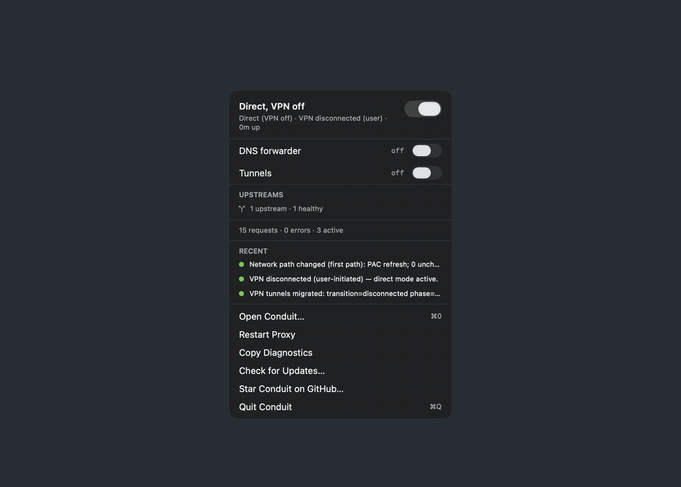

<div align="center">

# Conduit

A macOS menu-bar proxy manager for corporate networks: Kerberos, NTLM, PAC, and upstream failover in one native app.

[](https://github.com/srps/Conduit/releases/latest)
[](https://github.com/srps/Conduit/actions/workflows/swift.yml)
[](LICENSE)




</div>

## Why Conduit

Your company runs an explicit proxy that wants Kerberos or NTLM, a PAC file decides which hosts go where, and the VPN drops a few times a day. Browsers cope. Terminals, package managers, Docker, and Electron apps often do not. Conduit runs a local proxy on your Mac that handles the authentication for them, follows the PAC file, checks the health of every upstream, and moves traffic to a working route when the network changes. A generic HTTP or SOCKS5 upstream works too.

> I built Conduit out of my own necessity. Daily-driving macOS behind a corporate proxy, the constant proxy and VPN flakiness was a real drag, and I wanted one reliable tool that just worked whether I was on VPN or off it. PAC support and automatic proxy re-routing were my biggest pain point, so that's the core the rest is built around. Everything else (SOCKS5, DoH forwarding, tunnels, the menu-bar UI) started as nice-to-haves on top. It's open source in case it saves someone else the same trouble.

## Install

> [!IMPORTANT]
> Conduit runs on Apple Silicon Macs (M1 or later) with macOS 26 or later. Intel Macs are not supported.

**Homebrew**

```bash
brew install --cask srps/tap/conduit
```

**Disk image.** Download the arm64 `.dmg` from [Releases](https://github.com/srps/Conduit/releases/latest), open it, and drag **Conduit** into **Applications**. No Xcode or Swift install is needed.

**From source.** You need Xcode 26 (Swift 6.2). `bundle-app.sh` uses Xcode by default; a bare `swift build` also works with the Command Line Tools.

```bash
git clone https://github.com/srps/Conduit.git && cd Conduit
./bundle-app.sh --release --install   # builds, then installs to /Applications
```

`bundle-app.sh --install` quits and replaces a running Conduit. [`CONTRIBUTING.md`](CONTRIBUTING.md) covers source builds in full.

### First launch

> [!NOTE]
> Releases are signed with Conduit's self-signed release certificate ([release signing](docs/release-signing.md)) and are not notarized. If macOS blocks the first launch, open **System Settings > Privacy & Security** and click **Open Anyway**.

- **Updates.** Conduit updates itself from GitHub Releases through Sparkle. Use **Check for Updates…** in the Conduit menu or the menu bar popover, or turn on **Check for updates automatically** in **General > Updates**. Nothing installs until you choose to.
- **Privileged helper (optional).** **Manage macOS proxy settings** and **Manage system DNS** need the privileged helper, version 5. Dragging the app does not install it. Install it from Conduit's Settings. Everything else runs without it.

[Release installation](docs/release-installation.md) covers the helper's signing pin, rollback, and the update checks in detail. [Getting started](docs/getting-started.md) walks through the first configuration.

## Features

| Routing and auth | Network resilience | DNS |
| --- | --- | --- |
| Kerberos (Negotiate) and NTLMv2 to the upstream | Upstream health probes, circuit breaker, and automatic recovery | Local DNS forwarder with DNS-over-HTTPS fallback |
| PAC evaluation through macOS CFNetwork, the engine Safari uses | Ordered failover. A failed CONNECT retries the next upstream | Internal domains go to corporate DNS first |
| HTTP, HTTPS `CONNECT`, and SOCKS5 (IPv6 included) | Direct mode when off VPN and the upstreams are unreachable | Optional system DNS management, restored on stop or after a crash |
| `NO_PROXY` matching and `forceProxyHosts` overrides | VPN and network-change detection that drops stale PAC and DNS answers | VPN-aware: new interfaces are redirected, stale ones pruned |

| Menu bar and app | System integration | Advanced |
| --- | --- | --- |
| Menu bar glyph shows stopped, direct, proxied, or needs attention | macOS system proxy settings and local PAC serving | TCP tunnels and port forwards |
| Popover with switches, upstream lights, and the last three events | `HTTP_PROXY`, `HTTPS_PROXY`, and `NO_PROXY` for your shell | Gateway mode for Docker, VMs, and the LAN, with an allowed-client list |
| Filterable event list with copy buttons for LLM analysis | Split DNS through `/etc/resolver` | Transparent proxy for apps that ignore `HTTP_PROXY` (DNS intercept plus TLS SNI) |
| Optional global shortcut ⌃⌥⌘P to toggle the proxy | Login item, notifications, and config import and export | Credentials in the login keychain, never in plaintext |

Every routing, auth, failover, health, and config decision is a typed event. The app, `pmctl`, and the `pm-sim` simulator all read the same events, listed in the [event catalogue](docs/events.md).

<details>
<summary><strong>Full feature list</strong></summary>

### Core proxy

- Local HTTP proxy listener with configurable bind host and port
- NTLMv2 upstream authentication, compatible with corporate proxy infrastructure
- Kerberos (Negotiate) upstream authentication through the system GSS framework
- HTTPS tunneling via `CONNECT`
- Plain HTTP forwarding
- Bundled presets for generic setups, corporate proxy fleets, and self-hosted Squid
- Draggable upstream proxy ordering. The top-to-bottom order is saved as the failover priority.
- Upstream reachability probing without rewriting the configured priority order
- Automatic upstream failover. When a CONNECT tunnel fails, the coordinator retries through the remaining upstreams before it returns an error.
- Automatic direct-connect detection with a configurable TTL cache and progressive timeout backoff
- Off-VPN `directMode` that bypasses corporate upstreams when they are unreachable
- `NO_PROXY`-style matching for direct connections
- `forceProxyHosts` overrides for domains that must always use the upstream proxy
- Configurable connection timeout, direct-connect TTL, strict mode, and verbose logging

### PAC-aware routing

- Fetches and caches corporate PAC files. `http://` PAC URLs work through an ATS-safe curl fallback.
- Evaluates `FindProxyForURL()` through macOS CFNetwork, the OS-patched PAC engine Safari uses
- Keeps the PAC fallback-chain order (`PROXY -> PROXY -> DIRECT`) within the usable-route cap, which defaults to 32 and accepts 1 to 128. DIRECT is used only when policy permits and stays in the chain. See [PAC route admission](docs/pac-route-bounds.md).
- Native PAC DNS resolution. `dnsResolve()`, `myIpAddress()`, and `isResolvable()` run as Swift callbacks with a per-evaluation DNS cache, so `isInNet()` subnet checks work for hostnames.
- PAC helper functions `isPlainHostName`, `localHostOrDomainIs`, `dnsDomainLevels`, `shExpMatch`, and `dnsDomainIs` with their standard semantics
- Upstream PAC routing toggle that turns PAC-based internal routing on or off without clearing the PAC URL
- Adaptive local PAC serving. macOS can point at `127.0.0.1:<localPACPort>/proxy.pac` while Conduit keeps the upstream PAC URL as its internal routing source.
- Works in manual proxy mode. The system proxy stays on localhost, so CLI tools work, and routing decisions still use PAC internally.

### DNS-over-HTTPS forwarder

- Local UDP DNS forwarder that answers the machine's queries
- Response cache with LRU eviction, TTLs from the smallest record TTL, NXDOMAIN negative caching, and a 2,048-entry limit
- Internal domains (configurable) go through corporate DNS servers first
- External domains fall back to configurable DoH providers. The defaults are Cloudflare, Quad9, and Google.
- Connection cascade for DoH. For each provider in order, it tries a direct connection, then the upstream corporate proxy, then the local proxy.
- DNS intercept rules with wildcard patterns, such as `*.cursor.sh`, that return a synthetic loopback IP for transparent proxying
- Optional system DNS management. It sets macOS DNS to 127.0.0.1 on all connected interfaces, so every app uses the forwarder, including Cursor and other Electron apps that call `getaddrinfo`. A native Swift UDP relay on port 53 runs inside the privileged helper. A DNS pipeline liveness probe runs every 30 seconds and recovers the pipeline when it fails.
- VPN-aware DNS reconciliation. When interfaces appear or disappear on VPN connect or disconnect, new interfaces are redirected to the forwarder and stale entries are pruned from saved state.
- Crash recovery. Conduit saves the original DNS servers to disk and restores them on stop. After a crash or force quit, the next launch restores them unless another session still serves the machine. It tolerates vanished interfaces, detects stale state older than 7 days, and handles port-53 conflicts.
- Runs on its own as the `pm-dns` CLI or inside the app
- Fixes DNS resolution on VPNs where corporate DNS returns NXDOMAIN for public domains

### System integration

- macOS system proxy configuration via `networksetup`
- PAC toggle that turns automatic proxy configuration on or off without losing the PAC URL
- Shell environment variable management for `HTTP_PROXY`, `HTTPS_PROXY`, and `NO_PROXY`
- Split DNS support via `/etc/resolver`
- PAC file fetching and evaluation preview
- Login-item support
- Bundled `.app` wrapper script for local development builds
- Activation preflight that detects whether admin rights are needed before enabling or disabling
- No-op detection that skips privileged operations when the current state already matches
- Privileged helper daemon for one-time authorized system proxy, DNS management, and the DNS relay

### Reliability

- Connection pooling and keep-alive reuse
- Configurable health-check timeout (`connectionCheckTimeoutMS` in the config, default 2000 ms)
- Health checking and auto-recovery when upstream mode is active
- A slow origin behind a healthy upstream does not trip that upstream's circuit breaker on its own
- Stalled connection cleanup
- VPN and network change detection
- Port-retry logic on restart, so the proxy recovers cleanly after quick restarts
- NIO event loop safety. All cross-channel operations use `.hop(to:)` or Channel-level thread-safe APIs.

### UI

- Menu bar icon whose glyph carries the state (stopped, direct, proxied, needs attention), and a non-scrolling popover with the state line, switches for the proxy, DNS forwarder, and tunnels, upstream traffic lights, an activity line, the last three events, and Open, Restart, Copy Diagnostics, Check for Updates, and Quit
- One app window with a sidebar. It has Overview (module rows with switches, route, telemetry, and upstream health), Connections, Events, and one Configure section per subsystem (Proxy, Upstreams & Routing, Authentication, DNS, Tunnels, Shell Environment, General, Advanced). Each section pairs the subsystem's live state with its settings.
- Per-module error tracking. Proxy, DNS, and tunnel errors appear on their Overview rows. Other errors show in a dismissible banner.
- Inline validation on Configure sections, using the same validators as the config boundary
- Filterable event list with category chips (General, Proxy, PAC, Auth, Network, System, Tunnel), a level picker, text search, and copy buttons for LLM analysis
- First-run setup sheet at launch when NTLM credentials are missing, re-runnable from Authentication
- Keep-window-on-top option for demos and screen sharing
- Optional global shortcut (⌃⌥⌘P) to toggle the proxy from any app
- Notifications when run as an app bundle
- Config import and export
- Config files carry a `schemaVersion`. Older unversioned configs are normalized and rewritten on load.

### Advanced

- SOCKS5 proxy server with IPv6 support (ATYP 4)
- Gateway mode (`0.0.0.0`) for Docker, VM, and LAN use
- Allowed-client list for gateway deployments
- Cloud metadata endpoint blocking in gateway mode, which prevents SSRF to `169.254.169.254`, link-local, and loopback addresses
- TCP tunnel and port-forward definitions
- Transparent TCP proxy for apps that bypass `HTTP_PROXY`, such as Cursor's `http2.connect()`. It combines DNS intercept, TLS SNI extraction, and an authenticated CONNECT tunnel, with Cursor preset rules in Settings.
- Configurable max upstream connections and inbound connection limits, with warn and reject thresholds
- Configurable request body buffer limit, default 16 MiB. Oversized bodies are rejected before forwarding.
- Verbose logging toggle. It gates stderr output. The in-app ring buffer always captures all levels.
- Optional file logging to `~/Library/Logs/Conduit/proxy.log`

### Security

- Credentials stored in the macOS login keychain (the traditional keychain, so no entitlements are required)
- The NT hash is derived once and stored in the keychain
- No plaintext password persistence
- Helper daemon socket restricted to the `root:staff` group, with `getpeereid` peer validation and an optional caller-signing pin
- `setAutoproxyURL` URL scheme validation (http and https only) to prevent PAC URL injection
- Dedicated CONNECT tunnel connections are exempt from the stalled-connection reaper, so active tunnels are not killed by mistake
- `Proxy-Authorization` and `Authorization` headers are masked in every log sink

</details>

## How it compares

Conduit is the only one of these that ships a native macOS app. proxydetox has a basic menu-bar app you build from source; the others are command-line tools. This table reflects each project's README or documentation as of November 2026.

| Tool | Native macOS UI | NTLM | Kerberos | PAC | SOCKS5 | Tunnels | Upstream failover |
| --- | :-: | :-: | :-: | :-: | :-: | :-: | --- |
| [px](https://github.com/genotrance/px) (Python) | - | ✓ | ✓ | ✓ | - | - | Comma-separated list. Retries a proxy blocked by repeated 407s. |
| [alpaca](https://github.com/samuong/alpaca) (Go) | - | ✓ | macOS only | ✓ | SOCKS5 upstreams from PAC, opt-in | - | PAC order. Goes direct while the PAC proxies are unreachable. |
| [proxydetox](https://github.com/kiron1/proxydetox) (Rust) | Build from source | - | ✓ (Negotiate) | ✓ | - | - | PAC order |
| [cntlm](https://github.com/versat/cntlm) (C) | - | ✓ | [versat fork](https://github.com/versat/cntlm) | [versat fork](https://github.com/versat/cntlm) | ✓ | ✓ | Tries each parent proxy in order. Goes direct while all are unavailable. |
| **Conduit** (Swift) | ✓ | ✓ | ✓ | ✓ | ✓ | ✓ | Health probes, circuit breaker, and automatic recovery |

## Current limitations

- Conduit does not watch its config files. After an outside edit, Settings will not save over the file, and Overview offers **Reload from Disk**, which applies the changes it can.
- `ConduitDaemon` runs the shared runtime host, but it has no production control socket or LaunchAgent lifecycle yet. `pm-proxy` is the headless runtime, and `pmctl` drives its control socket.
- The privileged helper is a LaunchDaemon that talks over a Unix socket. It does not use Apple's `SMAppService` signed-helper flow, which Jamf and MDM distribution need.
- Builds are not notarized, and only Apple Silicon is supported.

## Contributing

Contributions are welcome. [`CONTRIBUTING.md`](CONTRIBUTING.md) covers building, the dev instance that runs beside your installed app, tests, the privileged helper from a source build, and the [product pillars](CONTRIBUTING.md#product-pillars) every change is measured against. [`docs/architecture.md`](docs/architecture.md) has the module graph. [`AGENTS.md`](AGENTS.md) holds the guardrails that humans and AI assistants both follow. To report a vulnerability, see [`SECURITY.md`](SECURITY.md).

Planned work lives in [`ROADMAP.md`](ROADMAP.md), and shipped changes in [`CHANGELOG.md`](CHANGELOG.md).

## License

[Apache License 2.0](LICENSE). Third-party notices are in [`NOTICE`](NOTICE).
