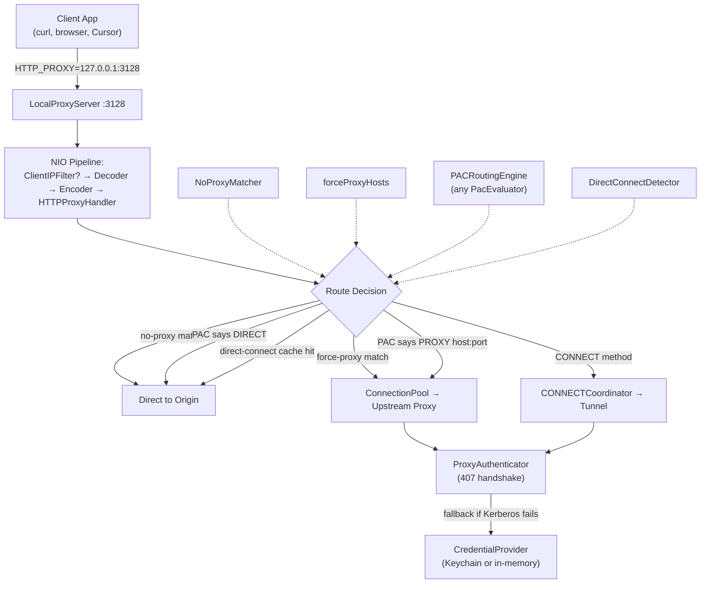

# Conduit Architecture

The selected staged shared-host architecture is in the
[runtime design](./design-runtime-host-contract.md) and decisions 0013–0015. The
owner authorized staged implementation; the overview below describes existing
code and does not claim that migration is complete. `Package.swift` is the authority for the current
target graph. See [ROADMAP](../ROADMAP.md) for execution order.

> Describes the multi-target shape that landed in the module split, plus the subsequent security additions (the CFNetwork PAC evaluator and `SecretBytes`) and the orchestrator/UI performance cleanup. For the file-by-file migration history and the rationale behind every seam, read [`docs/design-module-split.md`](./design-module-split.md). For current implementation rationale and priorities, read [`planning.md`](./planning.md) and [`ROADMAP.md`](../ROADMAP.md).

## Overview

Conduit is a macOS application that runs a local HTTP/SOCKS5 proxy server with corporate proxy authentication (Kerberos/NTLM), PAC-aware routing, DNS-over-HTTPS forwarding, protocol tunnels, and system integration. It bridges the gap between corporate proxy infrastructure and macOS applications that don't natively support authenticated proxies.

The codebase is a SwiftPM package. `Package.swift` is the authority for its targets and their direct dependencies; this document does not keep line or test counts, which go stale. Machine effects cross explicit protocol seams; kernel-facing contracts live in `Sources/ProxyKernel/Abstractions/` and macOS-specific collaborators in `PlatformMac`. Control and event values cross targets as package types.

```
Conduit/
├── Sources/
│   ├── ProxyKernel/          portable library (Foundation + NIO)
│   ├── ProxyAuth/            NTLM/Kerberos (GSS + CommonCrypto)
│   ├── ProxyPAC/             PAC evaluator (CFNetwork)
│   ├── ProxyControlBridge/   kernel and typed-event values → control wire values
│   ├── RuntimeEvents/        Foundation-only typed event values (decision 0013)
│   ├── PlatformMac/          macOS glue (Security, SC, SMAppService…)
│   ├── ConduitShared/        helper IPC and control wire contracts (no dependencies)
│   ├── Conduit/              SwiftUI GUI + wiring layer
│   ├── ConduitRuntime/       shared RuntimeHost, composed by the app and daemon
│   ├── ConduitDaemon/        user-session daemon entry point
│   ├── ConduitUpdater/       nested Sparkle updater
│   ├── ConduitHelper/        privileged LaunchDaemon
│   ├── pm-proxy/             headless HTTP/SOCKS5/DNS/tunnel CLI
│   ├── pm-dns/               standalone DoH forwarder
│   ├── pm-tunnel/            standalone TCP tunnel forwarder
│   ├── pm-sim/               fault-injection simulator
│   ├── pmctl/                control-socket command-line client
│   ├── pm-vpn-check/         VPN status diagnostic
│   ├── pm-auth-check/        auth diagnostic
│   └── pm-tls-check/         TLS-inspection diagnostic
└── Tests/
    └── ConduitTests/         unit, integration, and harness tests
```

SwiftNIO is a remote SwiftPM dependency (`https://github.com/apple/swift-nio.git`), resolved at build time — there is no vendored copy in-tree. Sparkle is a remote dependency too, and only `ConduitUpdater` declares it.

Line and test counts are not kept here. `swift test` and `find Sources -name '*.swift'` are the sources of truth.

## Target Dependency Graph

pm-sim uses the existing ProxyControlBridge target to exercise production protected-diagnostic-resource composition rather than duplicating its mapping. This adds no external dependency or kernel-to-control edge.

The load-bearing invariant: `pm-proxy` does **not** depend on `PlatformMac`. CI enforces the kernel import and `Process` fence, using the Swift compiler's own parse and the built object, with [`scripts/check-kernel-imports.py`](../scripts/check-kernel-imports.py). Linking alone cannot catch a stray Apple-framework import; Linux portability is not a current goal.

```mermaid
graph TD
    SwiftNIO["SwiftNIO (SPM)"]
    Sparkle["Sparkle (SPM)"]
    Shared["ConduitShared<br/>(helper and control wire contracts)"]
    Events["RuntimeEvents<br/>(Foundation-only typed events)"]
    Kernel["ProxyKernel<br/>(portable, Foundation + NIO)"]
    Auth["ProxyAuth<br/>(GSS, CommonCrypto)"]
    PAC["ProxyPAC<br/>(CFNetwork)"]
    Bridge["ProxyControlBridge<br/>(kernel to wire mapping)"]
    Platform["PlatformMac<br/>(Security, SC, SMAppService…)"]
    Runtime["ConduitRuntime<br/>(shared RuntimeHost)"]

    App["Conduit<br/>(SwiftUI GUI)"]
    Daemon["ConduitDaemon<br/>(entry point)"]
    Updater["ConduitUpdater<br/>(nested Sparkle updater)"]
    Helper["ConduitHelper<br/>(LaunchDaemon)"]
    PMProxy["pm-proxy<br/>(headless proxy)"]
    PMSim["pm-sim<br/>(simulator)"]
    PMTunnel["pm-tunnel"]
    PMDns["pm-dns"]
    PMCtl["pmctl<br/>(control client)"]
    PMVPN["pm-vpn-check"]
    PMAuthCheck["pm-auth-check"]
    PMTLS["pm-tls-check"]
    Tests["ConduitTests"]

    Kernel --> SwiftNIO
    Kernel --> Shared
    Kernel --> Events
    Bridge --> Kernel
    Bridge --> Shared
    Bridge --> Events
    Auth --> Kernel
    PAC --> Kernel
    Platform --> Kernel
    Platform --> Shared
    Platform --> Events
    Updater --> Shared
    Updater --> Platform
    Updater --> Sparkle

    App --> Kernel
    App --> Auth
    App --> PAC
    App --> Platform
    App --> Shared
    App --> Events
    App --> Bridge
    App --> Runtime

    Runtime --> Kernel
    Runtime --> Auth
    Runtime --> PAC
    Runtime --> Platform
    Runtime --> Bridge
    Runtime --> Shared
    Runtime --> Events
    Runtime --> SwiftNIO

    Daemon --> Runtime
    Daemon --> Bridge
    Daemon --> Kernel
    Daemon --> Auth
    Daemon --> PAC
    Daemon --> Platform
    Daemon --> Shared
    Daemon --> Events
    Daemon --> SwiftNIO

    PMProxy --> Bridge
    PMProxy --> Kernel
    PMProxy --> Auth
    PMProxy --> PAC
    PMProxy --> Shared

    PMSim --> Runtime
    PMSim --> Kernel
    PMSim --> Auth
    PMSim --> PAC
    PMSim --> Bridge
    PMSim --> Platform
    PMSim --> Shared
    PMSim --> Events
    PMSim --> SwiftNIO

    PMTunnel --> Kernel
    PMTunnel --> Auth

    PMDns --> Kernel
    PMCtl --> Shared
    PMVPN --> Kernel
    PMVPN --> Platform
    PMVPN --> SwiftNIO
    PMAuthCheck --> Kernel
    PMTLS --> Platform

    Helper --> Kernel
    Helper --> Shared

    Tests --> App
    Tests --> Runtime
    Tests --> Daemon
    Tests --> Bridge
    Tests --> Kernel
    Tests --> Auth
    Tests --> PAC
    Tests --> Platform
    Tests --> Shared
    Tests --> Events
    Tests --> SwiftNIO
```



| Target                 | ProxyKernel | ProxyAuth | ProxyPAC | PlatformMac | ConduitShared | RuntimeEvents | ProxyControlBridge | ConduitRuntime | NIO* |
| ---------------------- | :---------: | :-------: | :------: | :---------: | :-----------: | :-----------: | :----------------: | :------------: | :--: |
| `ConduitShared`        | —           | —         | —        | —           | —             | —             | —                  | — | —    |
| `RuntimeEvents`        | —           | —         | —        | —           | —             | —             | —                  | — | —    |
| `ProxyKernel`          | —           | —         | —        | —           | ✓             | ✓             | —                  | — | ✓    |
| `ProxyControlBridge`   | ✓           | —         | —        | —           | ✓             | ✓             | —                  | — | —    |
| `ProxyAuth`            | ✓           | —         | —        | —           | —             | —             | —                  | — | —    |
| `ProxyPAC`             | ✓           | —         | —        | —           | —             | —             | —                  | — | —    |
| `PlatformMac`          | ✓           | —         | —        | —           | ✓             | ✓             | —                  | — | —    |
| `ConduitRuntime` | ✓ | ✓ | ✓ | ✓ | ✓ | ✓ | ✓ | — | ✓ |
| `ConduitUpdater`       | —           | —         | —        | ✓           | ✓             | —             | —                  | — | —    |
| `pm-proxy`             | ✓           | ✓         | ✓        | —           | ✓             | —             | ✓                  | — | —    |
| `pm-sim`               | ✓           | ✓         | ✓        | ✓           | ✓             | ✓             | ✓                  | ✓ | ✓    |
| `pm-tunnel`            | ✓           | ✓         | —        | —           | —             | —             | —                  | — | —    |
| `pm-dns`               | ✓           | —         | —        | —           | —             | —             | —                  | — | —    |
| `pmctl`                | —           | —         | —        | —           | ✓             | —             | —                  | — | —    |
| `pm-vpn-check`         | ✓           | —         | —        | ✓           | —             | —             | —                  | — | ✓    |
| `pm-auth-check`        | ✓           | —         | —        | —           | —             | —             | —                  | — | —    |
| `pm-tls-check`         | —           | —         | —        | ✓           | —             | —             | —                  | — | —    |
| `ConduitHelper`        | ✓           | —         | —        | —           | ✓             | —             | —                  | — | —    |
| `Conduit` (app)        | ✓           | ✓         | ✓        | ✓           | ✓             | ✓             | ✓                  | ✓ | —    |
| `ConduitDaemon`        | ✓           | ✓         | ✓        | ✓           | ✓             | ✓             | ✓                  | ✓ | ✓    |
| `ConduitTests`         | ✓           | ✓         | ✓        | ✓           | ✓             | ✓             | ✓                  | ✓ | ✓    |

The matrix lists **direct** dependencies declared in `Package.swift`. `ConduitUpdater` is the only target that declares Sparkle. `Conduit` (app) and `ConduitDaemon` declare `ConduitShared` and `RuntimeEvents` themselves rather than reaching them through `PlatformMac`. Transitive reach is a separate question: `pm-proxy` declares no `PlatformMac`, and none of its declared targets (`ProxyKernel`, `ProxyAuth`, `ProxyPAC`, `ProxyControlBridge`, `ConduitShared`, `RuntimeEvents`) depends on it, so its closure contains no `PlatformMac`, Sparkle or `ConduitDaemon`. The kernel import fence in CI covers `ProxyKernel` and `RuntimeEvents`; the target graph is what keeps `PlatformMac` out of `pm-proxy`.

`ConduitRuntime` contains the one `RuntimeHost` composed by the app and daemon. The app uses the actual framed in-memory `RuntimeClient` and private editor client over its service. Production daemon ownership and v2 socket adoption remain later work; the in-process client boundary prepares that transport change. The runtime control cluster remains MainActor until its selected whole-cluster RuntimeActor move.

### What each target owns

- **`ConduitShared`** — zero-dependency wire contracts. The helper IPC (`HelperCommand`, `HelperRequest`, `HelperResponse`, input validation) is imported by the app and the helper so they can't drift. The control protocol carries the v1 socket types and the v2 runtime values (`ControlRuntime*.swift`), frame codec and `RuntimeClient` protocol (`RuntimeClient.swift`). The v2 protocol, framed client and bounded admission/subscription service are implemented (decision 0014); the shared RuntimeHost serves the app through the framed in-memory adapter, while production v2 socket adoption remains pending. Helper IPC and v1 control keep their own versions.
- **`ProxyKernel`** — portable library: proxy server, connection pool, PAC routing engine, DNS forwarder, transparent TCP proxy, tunnel forwarder, auto-recovery ladder, health checks, VPN state fusion, upstream probing, routing decisions, metadata blocklist, kernel-side abstractions. Imports only Foundation, Dispatch, NIO modules, Darwin/Glibc, `ConduitShared` (domain-name grammar) and `RuntimeEvents` (typed event values). CI runs `scripts/check-kernel-imports.py` to enforce this allowlist; `Process` is unavailable inside the kernel, and the script rejects a qualified `Foundation.Process` in the built object.
- **`RuntimeEvents`** — Foundation-only typed event values (decision 0013), with no dependencies. `LifecycleEvent` types the four `lifecycle.*` names with closed operation and reason enums and numeric fields; `RuntimeEventPayload` is the envelope's `typed` value. `ProxyKernel` carries it on `RuntimeEvent`. The shapes and bounds are in [`events.md`](./events.md#typed-lifecycle-payloads). `scripts/check-kernel-imports.py` limits this target to Foundation.
- **`ProxyControlBridge`** — maps kernel and `RuntimeEvents` values onto `ConduitShared` wire values, with exhaustive switches and no default cases. `ControlStatusMapping.swift` covers v1 status; `RuntimeEventControlProjection.swift` and `RuntimeSnapshotControlProjection.swift` cover the v2 values. `ProxyControlBridgeProtectedDiagnosticResources.swift` maps the runtime environment to the files a diagnostic writer must never write, including the control socket and daemon-ready names. Depends on `ProxyKernel`, `ConduitShared` and `RuntimeEvents`.
- **`ProxyAuth`** — opt-in capability layer. NTLM message generation (`NTLMAuth.swift`, CommonCrypto for MD4/HMAC-MD5), Kerberos/Negotiate (`KerberosAuth.swift`, GSS.framework), and `AuthenticatorFactory.swift` which assembles a `ProxyAuthenticator` from the active config + a `CredentialProvider`.
- **`ProxyPAC`** — opt-in capability layer with the CFNetwork-backed `CFPACEvaluator` (`CFNetworkExecuteProxyAutoConfigurationScript` on a private CFRunLoop, paired with `CFPacScriptEvaluator`). This is the sole production `PacEvaluator` implementation after the CFNetwork evaluator graduated; the JavaScriptCore-backed resolver was removed.
- **`PlatformMac`** — macOS-only glue. Keychain, `networksetup` wrappers, `SMAppService`, `SCDynamicStore`-based VPN monitor, `NWPathMonitor`, `/etc/resolver/*` writer, helper XPC client, shell runner, first-run example-corp preset injection. It depends on `ProxyKernel`, `ConduitShared` and `RuntimeEvents`, and is linked by the GUI app, `ConduitDaemon`, `ConduitUpdater`, `pm-sim`, `pm-vpn-check` and `pm-tls-check`. `pm-proxy` does not link it.
- **`Conduit`** (app target) — SwiftUI GUI, editor drafts and app administration. `AppComposition` explicitly supplies host effects; `AppState` opens one host and uses its framed clients. `RuntimeObserver` feeds bounded wire snapshots/pages into `RuntimePresentationAdapter`, while `RuntimeEditorSession` and its ledger track draft and receipt authority. It also hosts `AppLogStore`, the MainActor ring-buffered log store. Direct dependencies are listed in the matrix above.
- **`ConduitHelper`** — privileged LaunchDaemon at `/Library/PrivilegedHelperTools/io.github.srps.Conduit.Helper`. Communicates with the app over a Unix-domain socket at `/var/run/io.github.srps.Conduit.Helper.sock` using the `ConduitShared` contract. Depends on the kernel for `UDPRelay` / `TCPRelay` implementations.
- **Executables: `pm-proxy`, `pm-dns`, `pm-tunnel`, `pm-sim`, `pm-vpn-check`, `pm-auth-check`** — each is a narrow tool. `pm-proxy` is the flagship: it runs the full HTTP/SOCKS5/DNS/tunnel stack off `ProxyKernel`, `ProxyAuth` and `ProxyPAC`, and declares `ProxyControlBridge` and `ConduitShared` for its control socket, with no system-side effects (no Keychain, no `networksetup`, no `/etc/resolver`). `pm-sim` is the fault-injection harness used by CI.
- **`ConduitRuntime`** — the shared `RuntimeHost`, extracted with lifecycle policy and MainActor isolation preserved. It owns runtime composition with required explicit effects (decision0033), start-time and terminal-exit inputs. Both the app and daemon compose it; actual-host/client tests and scoped pm-sim scenarios drive it over explicit FakeMachine effects. RuntimeServiceProfile names and checks the app's shipping control-service capacities.
- **`ConduitDaemon`** — the user-session entry point over `RuntimeHost`, retaining arguments, configuration loading, signals and status output. It is not yet the production owner; the daemon milestones are in [ROADMAP](../ROADMAP.md).
- **`ConduitUpdater`** — the nested Sparkle updater. It is the only target that links Sparkle; see the updater section below.
- **`pmctl`** — command-line client for the control socket. It depends only on `ConduitShared`.
- **`pm-tls-check`** — TLS-inspection diagnostic over `PlatformMac`.

## Kernel Internals

### Directory layout

```
Sources/ProxyKernel/
├── Abstractions/    Cross-target protocols (the seam directory)
├── Models/          Config, status, upstream, log types, defaults
├── Proxy/           NIO handlers, orchestrator, CONNECT, SOCKS5, PAC routing, tunnels
├── Network/         AutoRecovery, DNS forwarder, relays, VPN fusion, probers
├── Security/        ProxyCredentials value type + in-memory provider
└── Support/         RuntimeEnvironment, error formatting, stock log sinks, TCP keepalive
```

### Abstractions directory (the seam)

`Sources/ProxyKernel/Abstractions/` contains the kernel-facing contracts. The table also includes platform-local contracts declared in `PlatformMac`. Keep each protocol focused on one responsibility.

| Protocol                 | Methods                               | Callers                                              | Conformers                                                                                              | Introduced               |
| ------------------------ | ------------------------------------- | ---------------------------------------------------- | ------------------------------------------------------------------------------------------------------- | ------------------------ |
| `LogSink`                | 1 (+ `minLevel` prop + `@autoclosure` ext) | 15 files (~21 init params)                          | `ConsoleLogSink`, `DiscardingLogSink`, `RecordingLogSink` (kernel), `AppLogStore` (app)                 | module split             |
| `CredentialProvider`     | 2 (`credentials(for:)`, `setCredentials(_:for:)`) | 1 (`AuthenticatorFactory`)                 | `CredentialManager` (PlatformMac, Keychain), `InMemoryCredentialProvider` (kernel, headless/test)       | module split (later widened) |
| `PacEvaluator`           | 3 (`fetchPAC`, `makeEvaluator`, `routeChain`) | 1 (`PACRoutingEngine`)                         | `CFPACEvaluator` (CFNetwork-backed, ProxyPAC)                                                           | module split (CFNetwork rework) |
| `PacScriptEvaluating`    | 1 (`resolveProxyChain(for:)`)          | 1 (`PACRoutingEngine.jsEvaluator`)                   | `CFPacScriptEvaluator` (ProxyPAC)                                                                       | module split (CFNetwork rework) |
| `PrivilegeClient`        | 2 (`execute`, `execute(batch:)`)      | 2 (orchestrator relay calls, platform managers)     | `HelperToolPrivilegeClient`, `AppleScriptPrivilegeClient`, `AuditingPrivilegeClient`, `RecordingPrivilegeClient`, `FakeMachine` (all PlatformMac) | pre-split (surfaced during split) |
| `HelperLifecycleManaging` (PlatformMac) | 2 methods (`installHelper(from:)`, `uninstallHelper`) + `status` property | 1 (`AppState` Settings surface)      | `HelperToolPrivilegeClient`, `FakeHelperLifecycle` (PlatformMac)                                        | dev mode (#24)           |
| `SecretStore` (PlatformMac) | 4 (`save`, `load`, `exists`, `delete`) | 1 (`CredentialManager`)                            | `KeychainStore`, `InMemorySecretStore` (PlatformMac)                                                    | dev mode (#24)           |
| `ProxyAuthenticator`     | 4 methods + `scheme` property; per-handshake state | 4 NIO handlers                                       | `NTLMAuthenticator`, `KerberosAuthenticator`, `NegotiateAuthenticator` (ProxyAuth), `MockAuthenticator` (pm-sim) | pre-split                |
| `VPNStatusObserving`     | 2 (`setOnChange`, `start`)            | 1 (`RuntimeHost`)                                    | `VPNStatusMonitor` (PlatformMac), `FakeVPNStatusObserver` (pm-sim/tests)                                | pre-split                |
| `TunnelResolverApplying` | 3 (`cleanupStale`, `applyAll`, `removeAll`) | 1 (`TunnelForwarder`)                          | `TunnelResolverManager` (PlatformMac); test no-op on demand                                             | module split             |

Notes:

- **Protocol size follows responsibility, not a universal three-method limit.** `SecretStore` has four required methods for credential storage, and `ProxyAuthenticator` has four methods plus its scheme property for a stateful handshake. The `PlatformIntegration` composite (originally planned as an 8-method god protocol) is deliberately deferred to the daemon-first work — see [`docs/design-module-split.md § PlatformIntegration (deferred)`](./design-module-split.md).
- **`package` access** everywhere. Types are visible within the SwiftPM package but not to external consumers. This access level limits external visibility; using protocols rather than concrete types at target boundaries remains an architectural rule reviewed at call sites.
- **`LogSink`'s `@autoclosure` extension** lets call sites skip message interpolation when a level is filtered out. `DiscardingLogSink.minLevel` returns `.error` (the highest case) so every `.debug`/`.info`/`.notice`/`.warning` call short-circuits before building the string.

### Models

`Sources/ProxyKernel/Models/` is pure Foundation — `Codable` value types that describe configuration, status, and log content.

| File                         | Contents                                                                                                                |
| ---------------------------- | ----------------------------------------------------------------------------------------------------------------------- |
| `ProxyConfig.swift`          | The ~50-field `Codable` root config + `testFixture()` (vendor-neutral)                                   |
| `ConfigDefaults.swift`       | `ConfigDefaultsProvider` protocol + `GenericDefaults` + `LegacyConfigMigration` (additive `decodeIfPresent` paths)     |
| `PresetLoader.swift`         | Bundled preset index/record loader for `Resources/Presets/*.json`; validates decoded configs before returning them      |
| `ConfigSections.swift`       | Nested `Codable` struct groupings referenced from `ProxyConfig`                                                        |
| `ConfigValidation.swift`     | Runtime problem classification for Settings and start/subsystem gates; storage format/resource acceptance is separate                |
| `ConfigDiff.swift`           | Subsystem-level delta between two `ProxyConfig`s, consumed by the runtime reconciler and reload                          |
| `ProxyStatus.swift`          | `ProxyRuntimeStatus`, `ProxyMetrics`, `DirectModeCause` — the runtime snapshot fields                                  |
| `UpstreamProxy.swift`        | `Hashable` value type — the key for `CredentialProvider` conformers                                                    |
| `RuntimeEvent.swift`         | Structured event kinds + `RuntimeEventLog` (NIO-safe ring buffer). Optional typed `RuntimeEventPayload` (`typed`) for migrated `lifecycle.*` names; the legacy initializer refuses that namespace. See STYLE rule 3 and [`events.md`](./events.md#typed-lifecycle-payloads). |
| `LogTypes.swift`             | `LogEntry`, `LogLevel`, `LogCategory` — consumed by every `LogSink` conformer                                          |
| `TunnelResolverPort.swift`   | `TunnelResolverPort.port = 15053` — the one constant shared between kernel (`TunnelForwarder`) and PlatformMac (`TunnelResolverManager`) |

### Proxy

NIO handlers, the orchestrator, routing, and tunneling.

- **`ProxyOrchestrator.swift`** — composes `LocalProxyServer`, `LocalDNSForwarder`, `TunnelForwarder`, `TransparentTCPProxy`, `TunnelDNSResponder`, `ConnectionPool`, `HealthChecker`, `AutoRecovery`, and `UpstreamProber` into one runtime. Takes `LogSink`, `CredentialProvider`, `PacEvaluator`, `PrivilegeClient`, `authenticatorProvider` — all protocol-typed; no `PlatformMac` concretes referenced. Exposes `configSnapshotProvider: @Sendable () -> ProxyConfig` — the one authoritative mirror of the live config, readable from any thread. **Two-tier snapshot emission** (added during the UI performance cleanup): state-transition callsites use `emitSnapshotImmediate()` (synchronous fire); per-request / per-connection / per-DNS-tick callsites use `emitSnapshotCoalesced()` (100 ms `DispatchSourceTimer` throttle). Counter-tier bursts collapse owner snapshot emission to at most ten per second; the bounded runtime service then supplies the UI's wire snapshots and pages. State-transition emissions cancel pending coalesced flushes so there's no double-emit. See "Cross-target wiring" below.
- **`LocalProxyServer.swift`** — binds the HTTP proxy listener (default `127.0.0.1:3128`, configurable; gateway mode binds `0.0.0.0`). NIO pipeline: `ClientIPFilter?` → `HTTPRequestDecoder` → `HTTPResponseEncoder` → `HTTPProxyHandler`. Conforms to `RecoverableProxyService` so `AutoRecovery` can restart it.
- **`HTTPProxyHandler.swift`** — per-request routing. Consults `NoProxyMatcher` (wildcards like `*.local`, `10.*`), `ForceProxy` overrides (e.g., `aka.ms` must always proxy), `PACRoutingEngine`, and `DirectConnectDetector` to decide direct vs upstream. Streams non-CONNECT requests through `ConnectionPool`.
- **`CONNECTHandler.swift`** + **`ConnectionPool.swift`** — dedicated raw-TCP CONNECT tunnels through upstream proxies, with the 407 handshake done in raw bytes (not NIO's HTTP parser state, which would corrupt on the retry). `ConnectionPool` tracks Keep-Alive reuse, `authenticated` flag, stalled-reaper lifecycle, per-upstream failover, and max-connection limit. Configured upstream priority is user-owned: Settings exposes it as draggable top-to-bottom order, and reachability probes do not rewrite it.
- **`SOCKS5Server.swift`** — optional SOCKS5 listener (default `127.0.0.1:1080`). State machine plus IPv6 routing; reuses the `CONNECTHandler` coordinator for upstream tunneling.
- **`PACRoutingEngine.swift`** — caches the `PacScriptEvaluating` across lookups, refreshes on a configurable interval, and enforces bounded construction / per-request evaluation timeouts. The concrete evaluator is CFNetwork-backed and supports the full `PROXY a; PROXY b; DIRECT` fallback chain.
- **`PACScriptEmitter.swift`** + **`LocalPACServer.swift`** — generate and serve the active local PAC at `http://127.0.0.1:<localPACPort>/proxy.pac` when `routing.localPACEnabled` is true. The server is a loopback-only NIO HTTP listener that serves precomputed PAC bytes with no-cache headers. `SystemProxyManager` points macOS auto-proxy at this local URL while `PACRoutingEngine` continues to consume the upstream PAC URL for Conduit's internal per-request routing decisions. In the Settings UI these are deliberately separate: "adaptive local PAC for macOS" vs "upstream PAC for Conduit routing."
- **`TunnelForwarder.swift`** — SSH-style `localPort:remoteHost:remotePort` TCP forwarding. Two modes:
  - **Proxied** (`proxied: true`): opens a dedicated `ConnectionPool` + `CONNECTCoordinator` (separate from the main HTTP pool) and CONNECTs through the corporate proxy with Kerberos/NTLM.
  - **Direct** (`proxied: false`): raw TCP relay, no upstream proxy.
  Buffers early client bytes until the upstream is ready. `ProtocolDetector` logs detected wire protocol (MongoDB, TLS, PostgreSQL, MySQL, Redis, AMQP, HTTP/2) on first data for proxied tunnels. All listeners bind loopback regardless of `localHost` — enforced by `effectiveTunnelListenHost`.
- **`TunnelDNSResponder.swift`** — self-contained UDP DNS mini-server on `127.0.0.1:15053`. Responds to A queries for active tunnel hostnames with the tunnel's listen IP; returns NODATA for AAAA (suppresses IPv6 delays); REFUSED for everything else (falls through to normal DNS). Case-insensitive hostname matching; dynamic on config change. The paired `/etc/resolver/<hostname>` file is written by `TunnelResolverManager` in PlatformMac via the `TunnelResolverApplying` protocol. See `docs/design-tunnel-dns-override.md`.
- **`TransparentTCPProxy.swift`** — captures traffic from apps that bypass `HTTP_PROXY`. DNS intercept rules in `LocalDNSForwarder` return a dedicated loopback IP for matched domains; the app connects to that IP; `SNIInterceptHandler` peeks the TLS ClientHello, extracts the real hostname, and `CONNECTCoordinator` establishes an authenticated CONNECT tunnel. TLS handshake completes end-to-end — Conduit never terminates TLS. 10-second handshake timeout, 16 KB peek buffer cap, per-label RFC 952 SNI hostname validation. See `docs/design-dns-intercept-transparent-proxy.md`.
- **`MetadataBlocklist.swift`** — in gateway mode, blocks all outbound paths (direct HTTP, direct CONNECT, proxied non-CONNECT, and `DirectConnectDetector` probes) to cloud metadata endpoints (`169.254.169.254`, `metadata.google.internal`, `metadata.azure.com`), loopback, and link-local addresses. Probes resolve first and connect to nothing when any resolved address is blocked.

### Network

Side-effect-free network logic. Everything macOS-specific (`VPNStatusMonitor`, `VPNDNSDetector`, `NetworkMonitor`) moved to PlatformMac during the module split; kernel keeps the observable state types and pure-logic state machines.

- **`LocalDNSForwarder.swift`** — DNS-over-HTTPS resolver. Listens on a configurable UDP port (default 5053). Cascades: direct HTTPS → through upstream proxy → through local proxy. Configurable DoH providers (default: Cloudflare, Quad9, Google) with ordered fallback. LRU response cache (2048 entries, min-RR TTL, 30 s NXDOMAIN negative cache, TXID rewriting). DNS intercept rules: pattern-matched domains return a synthetic A record pointing at a dedicated loopback IP (`127.44.3.0`) for the transparent TCP proxy.
- **`DNSWireFormat.swift`** — DNS message marshaling.
- **`UDPRelay.swift`** / **`TCPRelay.swift`** — primitives used by the helper daemon to bind privileged ports (53, 443) and forward to the user-space DNS forwarder / transparent proxy. Live in the kernel so the helper can link them without linking PlatformMac.
- **`UpstreamProber.swift`** + **`DirectConnectDetector.swift`** — the two probing surfaces. `UpstreamProber` tests reachability to each configured upstream proxy (initial ready-check + periodic re-probe); `DirectConnectDetector` probes and caches whether hosts are directly reachable for PAC + no-proxy routing decisions.
- **`HealthChecker.swift`** — periodic HEAD-through-the-pool liveness probe; drives `AutoRecovery` on failure.
- **`AutoRecovery.swift`** — the progressive recovery ladder when health checks fail: (1) close stalled connections → (2) re-authenticate (reset pool auth state) → (3) switch to next upstream → (4) restart the local proxy server. `LocalProxyServer` conforms to `RecoverableProxyService` to expose these operations.
- **`VPNObservedState.swift`** + **`VPNStateFuser.swift`** — the value-type and pure-logic state machine that fuses `VPNStatusObserving` events into transitions the orchestrator reacts to. `UtunRawObservation` is the raw event shape. `FakeVPNStatusObserver` in tests/`pm-sim` drives it without real `SCDynamicStore`.

### Security (kernel side)

- **`ProxyCredentials.swift`** — Foundation-only `Equatable` struct: `username`, `domain`, `workstation`, `ntHash: SecretBytes`. Explicit `keychainData()` serializer (not `Codable` — Keychain format is deliberately bespoke). `CredentialManagerError` lives next door. Consumed by `ProxyAuth` for NTLM token generation.
- **`SecretBytes.swift`** (added during the security-hardening work) — opaque class-backed `Sendable` struct used at every in-memory credential boundary. Three structural defenses: `CustomStringConvertible` + `CustomDebugStringConvertible` + `CustomReflectable` all return the redacted form `"SecretBytes(<redacted, N bytes>)"` (so `print` / `dump` / lldb `po` redact); deliberately **not** `Codable` (refuses accidental JSON serialisation); zeroes its backing storage on `deinit`. Access is via `withUnsafeBytes` / `withUnsafeMutableBytes` callbacks — there is no public byte-array accessor. `KeychainPayload` keeps `Data` for the bespoke Keychain wire format with explicit conversion at the boundary.
- **`InMemoryCredentialProvider.swift`** — `NIOLockedValueBox<[UpstreamProxy: ProxyCredentials]>`-backed `CredentialProvider`. Default-constructed empty store returns `nil` for every lookup (preserves the "no creds, fall back to Kerberos" semantics). Used by `pm-proxy`, `pm-tunnel`, `pm-sim`, and tests.

### Support

- **`RuntimeEnvironment.swift`** — narrow DI boundary for persistence paths (`configDirectory`, `configFile`, `savedDNSFile`, `exportDefaultFile`). Every executable constructs this explicitly at its boundary; kernel runtime services never read `PM_CONFIG_DIR` or other ambient process state directly. See [`docs/design-module-split.md § Pillar five`](./design-module-split.md).
- **`ProxyConfigPersistence.swift`** — atomic write + load for `ProxyConfig` JSON. File-only; no Keychain interaction.
- **`StandardLogSinks.swift`** — `ConsoleLogSink` (synchronous stderr write; default for headless daemons), `DiscardingLogSink` (no-op, `minLevel = .error` so the autoclosure always short-circuits; default for tests that don't care about log output), `RecordingLogSink` (`NIOLockedValueBox`-backed capture buffer; used by tests that assert on log content and by `pm-sim` scenarios that check severity).
- **`ErrorFormatting.swift`** — NIO channel/protocol error → human-readable string conversion.
- **`TCPKeepalive.swift`** — Darwin libc syscalls to tune `TCP_KEEPALIVE` on an NIO channel.

## Request Flow

Conceptual flow through an HTTP CONNECT request; unchanged from pre-split — only file paths moved.



1. **Inbound**: client points `HTTP_PROXY` / SOCKS env var at the local listener. In gateway mode (`0.0.0.0` bind), `ClientIPFilter` runs first and rejects peers outside `allowedClients`.
2. **Routing**: `HTTPProxyHandler` decides per-request — no-proxy match, force-proxy match, PAC decision, direct-connect cache, or CONNECT method — which mode to use.
3. **Upstream (non-CONNECT)**: `ConnectionPool` yields a Keep-Alive connection (per-upstream ID), `HTTPExchangeHandler` attaches `Proxy-Authorization`, handles 407 challenge-response, forwards the buffered request body, and streams the upstream response.
4. **CONNECT tunnels**: `CONNECTCoordinator` opens a dedicated raw TCP channel, `RawConnectHandshakeHandler` does the auth dance in raw bytes, then `TunnelRelayHandler` splices the channels.
5. **Auth**: every 407 path consults a `ProxyAuthenticator` from the `authenticatorProvider` closure; Kerberos tries first, NTLM lazy-falls-back only if Kerberos errors, and only then reads the `CredentialProvider` for stored hashes.
6. **Direct mode**: `HTTPProxyHandler` opens a direct TCP connection and strips `Proxy-Authorization` on the way out.
7. **SOCKS5**: `SOCKS5Server` runs the state machine and delegates upstream tunneling to the same `CONNECTCoordinator`.

### Auto-recovery & sleep/wake resilience

`AutoRecovery` runs the orchestrator's recovery ladder (stalled → re-auth → failover → restart). The shared host owns its lifecycle and connectivity coordination. The apparently unreachable legacy recovery-failure notification is tracked separately in #255; app adoption does not claim to repair that branch.

`RuntimeHost` receives wake observations through its injected `SystemWakeObserving` adapter to clear `DirectConnectDetector`'s stale TCP-reachability cache after sleep and trigger a full upstream re-probe + PAC refresh. An error-rate circuit breaker also triggers an immediate re-probe if 20+ request failures occur within 5 seconds (burst of failures during transient network disruption).

## Cross-target wiring

The app and daemon compose the same RuntimeHost over explicit effects. The headless proxy composes its kernel runtime directly without machine integration. These composition boundaries keep runtime ownership separate from UI and entry-point policy.

### GUI app (`AppState`)

`AppComposition` names the host's `RuntimeHostEffects` and the app's own administrative collaborators. `AppState` takes this composition and a prepared `StateRootSession`; startup migration and host opening run under that session. No app writer is constructed from raw paths.

The host owns the orchestrator, semantic configuration store/workflow, lifecycle intentions, reconciler baseline, platform managers, recovery and network/wake observations. `AppState` retains its clients, not those live collaborators. Runtime commands cross `RuntimeClient`; frozen configuration and preference edits cross `PrivateEditorClient`. The runtime service retains its host while clients and started physical work require it.

App responsibilities are split by purpose:

- `RuntimeEditorSession` submits frozen values; `RuntimeEditorLedger` tracks exact baselines, own receipts and later edits. A snapshot or another client's save never grants editor write authority. An explicit reload verifies files and reconciles eligible changes without silently discarding a local draft.
- `RuntimeObserver` owns one pull subscription and one coalesced page refresh. `RuntimePresentationAdapter` publishes bounded wire values. Stream loss, stale pages and unavailable lists remove current-state claims; aggregate row work obeys the same count/byte profile as capture.
- `AppState` owns draft editing, Settings debounce, import/export, notifications, windows, onboarding, PAC preview, helper installation, credential enrollment, login-item administration and updater policy. Document export uses the existing protected-destination guard.
- AppKit termination joins one Quit routine. Its single ten-second total includes final frozen saves and cleanup observation; expiry preserves unresolved recovery records and does not claim physical cancellation.

Production, dev and harness compositions explicitly provide every runtime effect. Dev and harness use FakeMachine, fake credentials/helper/login items and scratch paths. Notification authorization remains app-owned; real network-path and wake observation are explicit host adapters in the dev composition. They are not made fake by the bundle identity.

The app's old direct persistence, runtime-manager, reconciler and recovery callbacks are removed with this activation. Thin app/client tests retain draft, presentation, composition and termination policy; runtime lifecycle assertions belong to the shared host and its clients. RuntimeActor isolation and installed-machine acceptance are subsequent gates, not implied by this boundary.

### Dev instance (`Conduit --dev`)

`Sources/Conduit/App/DevLaunch.swift` is the harness's composition as a launch mode, compiled into debug builds only, so a second Conduit runs beside the installed one for visual and VoiceOver checks with isolated configuration and faked system-proxy, environment, resolver, helper, login-item, and credential operations. `AppState.forLaunch()` parses `--dev`, `--dev-state-dir`, `--section`, `--vpn` and `--upstream`, and builds `AppState` over `FakeMachine` (privilege client and command runner), `FakeLoginItems`, `FakeVPNStatusObserver`, `FakeHelperLifecycle` and `InMemorySecretStore`, with an isolated `RuntimeEnvironment` under `$TMPDIR/conduit-dev` that holds the config, journal, preferences, log, a scratch home and the fake resolver directory. The first launch seeds a config with every listener port at zero and the four platform switches off; later launches keep what was edited. This is not a fully side-effect-free process: it writes scratch state, starts real listeners and configured network requests, observes network paths, and can request or post system notifications.

The popover is shown in a clear `NSPanel` hosting `StatusBarView`, presented from the app delegate once launch has finished and registered with `AppWindowPresentation` so it counts as an app window; with `--section` the app window opens through the Open Conduit menu command. Both presentations are logged to the state directory's `proxy.log`, which is what a script checks. The instance stays a regular app (Dock icon), badges its status-item glyph with a dot, and installs only the in-app shortcut monitor, never the system-wide one. It is launched with `open -n … --args --dev`: `-n` starts a new instance instead of activating the installed app, and a GUI process launched directly from an agent session has no window server access. The dev app bundle with its own identifier is #23.

### Headless daemon (`pm-proxy`)

`Sources/pm-proxy/PMProxy.swift` is the `PlatformMac`-free equivalent. Same orchestrator, different wiring:

- `InMemoryCredentialProvider()` instead of `CredentialManager` — empty store, every credential lookup returns `nil`, auth handshakes fall back to Kerberos (which is the healthy path on a Mac with a current TGT from `kinit`)
- `ConsoleLogSink(minLevel:)` instead of `AppLogStore` — synchronous stderr writes, no MainActor pressure
- `CFPACEvaluator()` injected as `pacEvaluator` (pm-proxy links `ProxyPAC`)
- No `PrivilegeClient` — privileged operations (`applyDNS`, port 53 relay) throw `PrivilegeClientError.executionFailed` and the kernel downgrades to an info log. The `--no-system-*` flags are implicit: `pm-proxy` cannot write `/etc/resolver`, cannot set system DNS, cannot install login items, cannot send user notifications. `otool -L .build/debug/pm-proxy` shows no linkage against `Security.framework`, `SystemConfiguration.framework`, `UserNotifications.framework`, or `ServiceManagement.framework`.
- NDJSON status writer — emits a `ready` event after successful bind; periodic snapshots when `--status-interval` is set.

The package graph keeps these platform dependencies out of pm-proxy; the kernel import fence checks its narrower allowlist.

### Simulator (`pm-sim`)

`Sources/pm-sim/` runs isolated fault-injection scenarios. Kernel scenarios construct their own orchestrator with recording/discarding logs and injected auth/credential/observer services. Under decision [0033](decisions/0033-headless-real-host-simulation.md), headless host scenarios may also depend on `ConduitRuntime` and compose the actual `RuntimeHost` through its production lifecycle facade. Store/workflow internals remain private. Scenarios inspect structured events and actual fake-machine state rather than copying the runtime policy.

Host composition requires explicit effect inputs through `RuntimeHostEffects`. Production assembly in `ConduitDaemon` selects its real credential, helper, observer, auth/PAC, process/probe and path adapters; tests and simulator scenarios select fakes and owned scratch paths. The helper factory receives the existing event-log sink before it creates its client, and the VPN monitor factory receives readers of current flap timings. No second event buffer or runtime implementation is needed. Explicit system GSS selection retains the auth factory's KDC recovery/event binding.

The module dependency grants reach, not isolation. A scenario must supply every effect, own its loopback listeners and scratch-root authority, and confirm logical/physical cleanup before removing state. The app uses the same host with its own explicit composition; the updater remains excluded. The simulator edge adds no third-party package and does not change pm-proxy's platform exclusion.

### Config snapshot invariant

`ProxyOrchestrator.configSnapshotProvider: @Sendable () -> ProxyConfig` is the **one** authoritative mirror of the live config, readable from any thread (MainActor or NIO event loop). Allocated once at init; the orchestrator's `config` setter updates the box before running side-effects, so the closure never returns a snapshot older than the in-flight reload.

Before the module split there were three parallel boxes — orchestrator, `AppState.configBox` fed by a `$config` Combine sink, and `pm-proxy`'s local `NIOLockedValueBox<ProxyConfig>`. The split collapsed the two caller-side mirrors into captures of `configSnapshotProvider`. A manual source check shows this:

```text
rg 'NIOLockedValueBox<ProxyConfig>' Sources/ -l | wc -l  →  1
```

The one surviving match is the orchestrator's internal box. `VPNStatusMonitor`'s `vpnFlapWindowBox` mirrors two `TimeInterval` fields (not the whole config), lives on a different concern, and doesn't count.

## Privileged Helper

`ConduitHelper` is a LaunchDaemon installed at `/Library/PrivilegedHelperTools/io.github.srps.Conduit.Helper` that runs as root.

- **IPC**: Unix domain socket at `/var/run/io.github.srps.Conduit.Helper.sock`, permissions `root:staff 0660`; peer connections restricted to the console-user UID via `getpeereid` + `SCDynamicStoreCopyConsoleUser`.
- **Caller identity** (#46): when `/Library/Application Support/io.github.srps.Conduit/helper-callers.req` exists (root-owned, written by `install-helper.sh`), a peer must also satisfy that code-signing requirement — the leaf certificate of the local signing identity and the app/daemon identifiers — and be signed with the hardened runtime. The helper reads the peer's audit token with `LOCAL_PEERTOKEN` and checks it with `SecCodeCopyGuestWithAttributes` + `SecCodeCheckValidity`. No file: identity is logged but not required ("unenforced"). An unsafe file: every caller is refused. See `HelperCallerIdentity.swift`.
- **Commands** (defined in `Sources/ConduitShared/HelperContract.swift`): apply / clear system proxy, apply / clear DNS resolvers, set DNS servers, start / stop DNS relay (port 53), start / stop TCP relay (port 443), set autoproxy URL.
- **Input validation** happens in `ConduitShared` so both the app and the helper agree on the accepted shape; port values validated to 1–65535 at both the IPC and the relay layers.
- **Relays**: `UDPRelay` (port 53 → forwarder) and `TCPRelay` (port 443 → transparent proxy high port) run inside the helper process. The relay primitives themselves live in `Sources/ProxyKernel/Network/` so the helper can link them without pulling in the full `PlatformMac` glue.

`SMAppService`-based installation is planned alongside Developer ID signing (see [`ROADMAP.md`](../ROADMAP.md)); the LaunchDaemon today is installed via `./install-helper.sh`.

## Configuration

`ProxyConfig` in `Sources/ProxyKernel/Models/ProxyConfig.swift` is a `Codable` struct with ~50 fields covering:

- **Network**: local host / port, SOCKS port, upstream proxies ordered by priority, PAC URL
- **Auth**: mode (Kerberos default / NTLMv2), username, domain, workstation
- **Routing**: no-proxy hosts, force-proxy hosts, upstream PAC routing toggle, adaptive local PAC server settings
- **System**: manage system proxy, environment variables, DNS resolvers
- **DNS**: forwarder port, DoH providers, manage system DNS
- **DNS intercept**: `dnsInterceptRules` (pattern, interceptIP, enabled), `transparentProxyEnabled`, `transparentProxyIP`, `transparentProxyPort`
- **Tunnels**: `tunnelDefinitions` (local port, remote host/port, proxied flag, preset, label), `maxTunnelSessions`, `maxSessionsPerTunnel`
- **Limits**: max connections, stalled timeout, body buffer limit, connection thresholds
- **Behavior**: gateway mode, strict mode, auto VPN enable/disable, verbose logging
- **UI**: menu bar icon, floating window, global shortcut

All fields have defaults via `GenericDefaults`. The `Codable` decoder uses `decodeIfPresent` with fallbacks for backward compatibility — new fields are additive, old persisted configs load unchanged. `ProxyConfigPersistence.loadMigrating(from:)` detects unversioned or older `schemaVersion` values, decodes through that tolerant path, then atomically writes the normalized current schema back to disk. Vendor-specific profiles are data resources loaded through `PresetLoader`, not Swift defaults.

Two factory methods coexist:

- `ProxyConfig.testFixture()` — vendor-neutral populated valid config for tests that need upstreams without reaching real infrastructure.
- `PresetLoader.load(_:)` — loads bundled preset records (`config`, optional platform settings, optional app preferences) from `Sources/ProxyKernel/Resources/Presets/`.
- `ProxyConfig.currentSchemaVersion` — persisted runtime config schema marker. Version `1` is the current flat JSON schema; legacy files without the marker migrate automatically on load.

## Testing

Tests live in `Tests/ConduitTests/`. Counts and skips are not recorded here: `swift test` and CI report the current run. The stage-1 runtime foundation's tests and focused evidence are listed in [`runtime-client-stage1-inventory.md`](./runtime-client-stage1-inventory.md).

Coverage includes:

- NTLM message generation, challenge-response, NT hash
- `ProxyAuthenticator` protocol conformance (NTLM, Kerberos, Negotiate fallback)
- Connection pool behavior (exhaustion, stalled reaper, dedicated tunnels, failover)
- CONNECT tunnel handshake (timeouts, 407 retry, raw-byte state machine)
- Streaming exchange (non-CONNECT proxied requests)
- PAC evaluation (routing decisions, DNS callbacks, per-evaluation caching)
- SOCKS5 (IPv6 routing, state machine)
- DNS forwarder (wire format, resolution, cache, intercept rules)
- `SystemDNSManager` lifecycle (apply / clear / reconcile / crash recovery)
- Config serialization + additive-field migration
- `VPNDNSDetector` and `VPNStateFuser` fusion logic
- Security (`ClientIPFilter`, `MetadataBlocklist`, body buffering, SNI parser edge cases)
- Protocol detection (MongoDB, TLS, PostgreSQL, MySQL, Redis, AMQP, HTTP/2)
- Protocol tunnels (proxied + direct, startup result reporting, session-limit enforcement, gateway-mode loopback policy)
- Tunnel DNS override (`TunnelDNSResponder` A/AAAA/REFUSED, case-insensitive lookup, dynamic hostname updates, `TunnelResolverApplying` command verification)
- Tunnel session tracker (global + per-tunnel limits, acquire/release)
- Sleep/wake recovery (direct-mode toggle via probe results, cache invalidation, health-checker lifecycle)
- Agent-isolated runtime (`RuntimeEnvironment`, `ProxyOrchestrator`, ephemeral bind reporting, NDJSON status streaming)
- TCP relay (lifecycle, port overflow rejection, privileged-port failures)
- Transparent proxy config (defaults, `Codable` round-trip, backward-compatible decoding)
- Logging (`LogSink` conformance, `@autoclosure` short-circuit, `RecordingLogSink` capture, file-logging level gating)

Test doubles mirror the protocol surface. The platform ones live in `Sources/PlatformMac/PlatformFakes.swift` because the dev instance runs over them too: `RecordingPrivilegeClient`, `FakeMachine` (a described machine that answers the `networksetup` and `launchctl` reads and applies privileged writes to its own model), `FakeLoginItems`, `FakeHelperLifecycle`, `InMemorySecretStore`. The kernel-side ones are `RecordingLogSink`, `FakeVPNStatusObserver`, `MockAuthenticator` and `InMemoryCredentialProvider`. No test constructs a `CredentialManager` over the real `KeychainStore`, a `SystemProxyManager` over the real machine, or a `VPNStatusMonitor` unless it specifically exercises that concrete's Keychain / `networksetup` / `SCDynamicStore` behavior; the `AppState` harness injects the helper and credential fakes, avoiding installed-helper operations and login-Keychain access through those collaborators. Notification and network-path integrations remain real, as described above.

## CI invariants

CI runs the kernel import/Process fence and its negative fixtures after building (the Process check reads the kernel object). The release workflow runs it again on the release build:

```sh
export DEVELOPER_DIR="/Applications/Xcode.app/Contents/Developer"
python3 scripts/check-kernel-imports.py
python3 scripts/test-kernel-imports.py
```

The allowlist is Foundation, Dispatch, NIO modules, Darwin/Glibc,
`ConduitShared` (domain-name grammar) and `RuntimeEvents` (typed event values).
`RuntimeEvents` itself may import Foundation only. Attributed, scoped and conditional
imports are checked too. The Process scan conservatively includes literals and
interpolations. The script fails if no Swift sources are found. Platform
frameworks and machine side effects belong behind protocols in `ProxyAuth`,
`ProxyPAC` or `PlatformMac`; a successful link does not enforce that boundary.

Other architecture checks, such as inspecting `pm-proxy` with `otool -L` and
checking config-lock ownership, remain manual diagnostics, not CI guarantees.

## What's next

The module split is complete. The CFNetwork PAC evaluator and `SecretBytes` shipped afterward, and a security-hardening wave tightened helper IPC versioning + IPv6 metadata canonicalisation. A UI performance cleanup cut menu-bar CPU spikes via the orchestrator's two-tier snapshot emission + an O(1) active-connection store + the Settings UI for the CFNetwork evaluator. The security-foundation batch added the threat model, centralized log/event sanitization, `pm-proxy` auth outcome parity, SNI false-positive fuzz coverage, and DNS question-match checks before cache/forward. Sequencing + scope sketches for the rest live in [`docs/design-split-followups.md`](./design-split-followups.md); priorities and status live in [`ROADMAP.md`](../ROADMAP.md), with acceptance criteria in [`planning.md`](./planning.md).

- **`pm-tunnel` auth-event carrier** — `pm-proxy` now reports runtime auth outcomes through the orchestrator, but `pm-tunnel` still constructs the tunnel stack directly and has no `RuntimeEventLog` owner. Add one only when the event-stream shape needs it.
- **Reliability scenarios** — `auth-storm`, `connection-flood`, and `upstream-flap` exist; audit remaining tunnel-health and DNS-poison coverage against the queue in `ROADMAP.md`.
- **Preset externalization shipped** — vendor defaults now live in bundled JSON resources; runtime persistence falls back to generic defaults.
- **`PlatformIntegration` design** — the composite protocol for system-proxy / DNS / env / login-item side-effects, driven by the control-plane reload path's actual call sites (not speculation). See [`docs/design-module-split.md § PlatformIntegration (deferred)`](./design-module-split.md) for why the 8-method god protocol was rejected during the split.

## References

- [`docs/design-module-split.md`](./design-module-split.md) — file-by-file migration history, per-stage shipped notes, deviations, and the lessons that carried forward.
- [`docs/design-split-followups.md`](./design-split-followups.md) — sketches for the security, daemon-first, and OSS-prep follow-ups with sequencing and explicit non-goals.
- [`docs/design-tunnel-dns-override.md`](./design-tunnel-dns-override.md) — `TunnelDNSResponder` + `TunnelResolverManager` design.
- [`docs/design-dns-intercept-transparent-proxy.md`](./design-dns-intercept-transparent-proxy.md) — DNS intercept + transparent TCP proxy design.
- [`docs/design-vpn-flap-resilience.md`](./design-vpn-flap-resilience.md) — `VPNStatusObserving` + `VPNStateFuser` design. Precedent for the side-effect-behind-protocol pattern.
- [`docs/auth-architecture.md`](./auth-architecture.md) — the `ProxyAuth` module's NTLM / Kerberos / Negotiate handshake details.
- [`docs/STYLE.md`](./STYLE.md) — engineering discipline: bounded everything, structured events first, side-effects behind protocols, deterministic where possible.
- [`AGENTS.md`](../AGENTS.md) — import-fence statement, side-effects-behind-protocols rule, toolchain / test commands.
- [`planning.md`](./planning.md) — current implementation rationale, dependencies, and acceptance criteria.
- [`ROADMAP.md`](../ROADMAP.md) — execution queue and sole product-work status tracker, with pillar tags.

## Candidate update preflight (0.5.3)

`ConduitUpdater` remains the only target linking Sparkle. It also links
`PlatformMac` for bounded archive download, static code validation and process
launch. `PreflightingUserDriver` decorates Sparkle's user driver and intercepts an
explicit install choice before Sparkle can stage install-on-quit.
`UpdateInstallGate` owns the observable decision; `UpdatePreflighting` is its
platform seam, with `SystemUpdatePreflight` and `FakeUpdatePreflight` implementations.
No app lifecycle or helper IPC contract is duplicated in the updater.

Sparkle's public API does not expose its extracted candidate. Preflight therefore
obtains a separately bounded copy, verifies the host's Ed25519 signature, inspects
and extracts it, checks actual code/bundle/platform/destination compatibility,
then runs the candidate's early `UpdateHelperPreflightWorker`. That worker exists
before app composition and only reads helper availability and issues a ping using
the existing versioned protocol. Static validation checks the root-owned pin;
the ping checks the helper's actual loaded policy. The updater itself is never
admitted as a helper caller. Sparkle independently authenticates the installation
archive against the same signature. See `release-installation.md` for bounds,
cleanup and the old-updater transition, and `validation-0.5.3.md` for installed
acceptance that stand-in hosts cannot establish.
