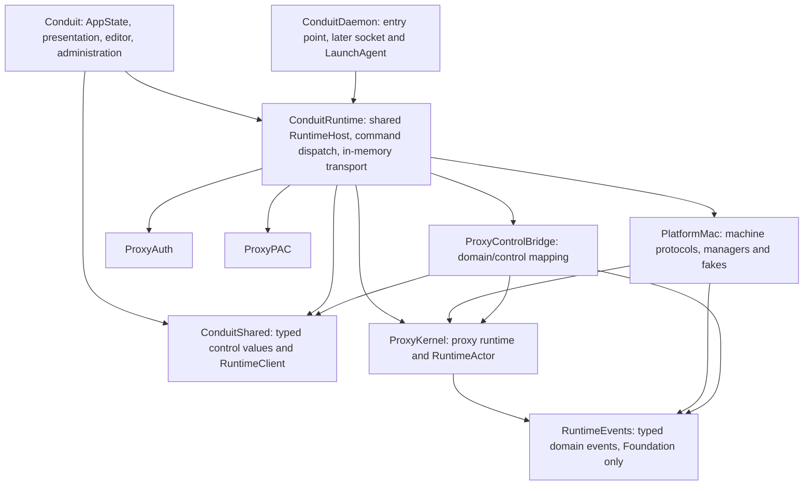

# Shared runtime contracts and host: owner review draft

Date: 2026-10-24. Status: **selected architecture; staged implementation authorized**.
Implementation status: the stage-1 foundation (typed lifecycle events, control value types and codec, the `RuntimeClient` protocol) is merged and unreleased. `ConduitRuntime` holds the mechanically extracted RuntimeHost. PR #235 supplies the unadopted bounded service behind the framed client; actual RuntimeHost adaptation, AppState adoption and the production v2 socket remain pending. See the [stage-1 inventory](./runtime-client-stage1-inventory.md).

Prepared by Codex with Claude Code architecture and persistence-policy review,
using the owner's `claude.ai` Max subscription. The owner selected the module and
isolation shape, save-before-apply with Stop/Quit exceptions, and the current
client/stream recommendations, then authorized staged implementation after a
final check against overalls' lessons ([#186](https://github.com/srps/Conduit/issues/186)).
Claude implements and verifies bounded slices; Codex reviews each checkpoint.

The accepted refinements are recorded in
[0013](./decisions/0013-runtime-module-isolation.md),
[0014](./decisions/0014-runtime-client-stream.md), and
[0015](./decisions/0015-save-before-apply.md), and
[0017](./decisions/0017-exclusive-state-directory-writer.md).
[0016](./decisions/0016-isolated-development-bundle.md) records the first dev-bundle
slice. Existing accepted records retain their decisions. Illustrative type names,
config field projection, listener handoff and unmeasured resource
limits remain design work, with explicit gates below. Authorization is not an
implementation or real-machine validation claim. [ROADMAP](../ROADMAP.md) remains
the queue.

## Selected refinements and current evidence (2026-10-25)

The private payload and canonical writer root were selected in 0018/0020. The owner
refined the root layout to **fixed writable filenames** in
[0028](decisions/0028-fixed-writable-state-filenames.md), superseding 0020 while
carrying forward its containment, lease, alias and separate-writer rules. Writable
app/daemon components use `config.json`, `platform.json`, `preferences.json` and
`platform-state.json`; diagnostic tools retain arbitrary read-only inputs.
Unsupported daemon custom names must refuse before migration/recovery with
move/rename guidance and preserved bytes. No automatic import is selected.
Fixed names do not replace diagnostic destination or canonical identity checks.
Naming enforcement and startup lease adoption are implemented in PR #236. Complete
store/workflow adoption and writer quiescence remain open.

The owner
subsequently selected resource limits at update/startup/import boundaries in
[0021](decisions/0021-bounded-configuration-at-all-boundaries.md), completed string
categories and legacy-file compatibility in
[0022](decisions/0022-configuration-identity-path-and-host-bounds.md), and selected
schema2 exact persistence in
[0023](decisions/0023-exact-schema-two-persistence.md). These records override earlier
provisional/no-count/startup-unchanged assumptions in this working design.

The profile caps DoH providers 8, DNS servers/domain 8, upstreams 32, configured local
tunnel forwards 128 (primary performance case 64), and DNS entries/intercepts/client/
forced-proxy lists 256. Existing bypass bounds remain. Display/identity strings are
1,024 UTF-8 bytes, URLs 16,384, audit path 1,023, host/domain/address 253 and wildcard
intercept patterns 255 with leading `*.`; retain stricter grammars. Keep the complete
8 MiB private frame and bound actual runtime-file reads at 8 MiB. Count disabled/raw
stored values, reject before typed JSON expansion/save, and preserve rejected
files. Legacy unknown fields and first-known-duplicate-wins semantics survive
bounded filtering; private wire remains strict. One active private body/decode
must leave Stop/status independent. No snapshot registry or chunking is selected.

Schema2 stays. Fix whole-millisecond round trips; refuse a durable value that
cannot reproduce required frozen runtime fields after bounded encode/decode.
Private/domain values remain canonical seconds. No silent normalization/schema3.
The alternatives and revisit triggers are in the records above.

PR225 introduced the layout/OS-lease primitives; PR236 consumes them at app and
daemon startup, before migration or recovery. PR226 merged diagnostic destination
guards at e5156b2 after local/hosted checks; #222 is closed. The private codec/bridge
is merged and unadopted. Runtime/file bounds and exact persistence merged in
PRs 227–230; PR231 adds the ordinary framed client. PR232 merges the unadopted
verified-store core with one shared loader and replacement path. It passed all
39 local checks and hosted Swift/CodeQL; optional hosted review failures are not
clean-review evidence. See [the store verification](verification-configuration-store-2026-10-25.md).
PR235 merges the bounded admission, observation, page and replay service with its
models; the real host/client adapter remains unadopted. PR242 connects the store to
private session authority. PR243 implements mandatory effects and actual-host
pm-sim coverage under decision0033. Actual store/workflow adoption is in progress;
AppState convergence, RuntimeActor and release readiness remain open. Current
status belongs in [ROADMAP](../ROADMAP.md), with per-slice verification linked there.

Release scratch probes distinguish high-water RSS, current footprint and live
allocator bytes. All-forms128-tunnel fixtures peaked at 17.3/21.0 MB RSS; a separate
staged-lifetime probe retained roughly 1.1 MB additional live allocator bytes with
only final values, while RSS remained at 15.6/20.4 MB. These are single-run synthetic
codec observations, not active-listener, traffic, steady-app, busy-peer, exhaustive
maximum or Stop-latency evidence. See the [sources and raw results](experiments/private-configuration-codec/README.md).

## Purpose and current constraints

Daily use is stable. Reduce defects discovered during development by combining
one implementation of runtime policy, types that reject invalid combinations,
and independent models that explore operation orderings. Type safety and model
checks accompany each host slice; neither requires a whole-repository conversion
before extraction.

The current sources establish several constraints:

- [AppState](../Sources/Conduit/App/AppState.swift) and
  [RuntimeHost](../Sources/ConduitRuntime/RuntimeHost.swift) are separate
  main-actor runtime hosts. The existing daemon is not the installed production
  owner and has no production control server.
- [ProxyOrchestrator](../Sources/ProxyKernel/Proxy/ProxyOrchestrator.swift),
  [LifecycleLane](../Sources/PlatformMac/LifecycleLane.swift),
  [RuntimeReconciler](../Sources/PlatformMac/RuntimeReconciler.swift) and
  [ConfigReapplyRetry](../Sources/PlatformMac/ConfigReapplyRetry.swift) also depend
  on main-actor isolation. Moving the host alone cannot complete isolation.
- [DaemonClient](../Sources/ConduitShared/DaemonClient.swift) is synchronous and
  reads a response until EOF; it is not the proposed subscription-capable client.
  That v1 control frame bound is 16 KiB. The separate v2 ordinary reply/stream
  ceiling is 64 KiB under0030; its remaining production profile is unselected.
- [ControlDaemonStatus](../Sources/ConduitShared/ControlProtocol.swift) omits VPN,
  error, upstream, connection and other state rendered by
  [RuntimePresentationAdapter](../Sources/Conduit/App/RuntimePresentationAdapter.swift).
  Reusing that thin status as the entire UI contract would lose behavior.
- [RuntimeEvent](../Sources/ProxyKernel/Models/RuntimeEvent.swift) has string names
  and details. The initial inventory before the first typed-family migration found 108 detail-matching expressions
  across 47 simulator/test files; these are migration inventory, not 108 proven bugs.
- AppState persists config, platform integration and UI preferences in separate
  writes. They are not one atomic transaction. #182 versions the platform-state
  journal, not these configuration files.
- #207's stale health-completion fence, #211's split-DNS repair and #212's
  reapply retries/PAC repointing already shipped in 0.5.7. They are baseline
  behavior to preserve and model, not work awaiting a sequencing decision.

## Selected ownership and dependency shape



Owner-selected target placement (2026-10-24):

- Add **ConduitRuntime** for the shared host. Putting it in PlatformMac would
  broaden PlatformMac's dependency graph to auth, PAC and control mapping;
  ConduitUpdater already links PlatformMac. Keep the updater out of that graph.
- Keep control commands, result DTOs, snapshot DTOs and the async client interface
  and **ControlCodec** in **ConduitShared**, with no dependency on ProxyKernel.
  Keep **ProxyControlBridge** as the domain/control projection layer;
  transport/server adapters belong above it. Control event records are a distinct
  typed wire projection, not RuntimeEvents producer cases. ConduitShared does not
  import RuntimeEvents; exhaustive bridge switches and compatibility fixtures
  check the mapping.
- Add a small **RuntimeEvents** target for reusable domain event cases and
  safe diagnostic text. It has Foundation only, no commands, sockets, platform
  services or kernel objects. ProxyKernel must not import a combined
  event/control-client target. Introduce this small target with the first family,
  avoiding a second event-type move later.
- Keep existing grammar, helper IPC and configuration file formats in place for
  now. The full #78 split and broad #85 kernel decomposition are not prerequisites.
- New first-party declarations use `package` access. No external package or
  concrete cross-target public API is proposed.

The composition boundary injects existing managers/services, paths, fakes, clocks,
credential provider, observer seams and shutdown policy. It does not introduce a
protocol per manager or a generic service locator. AppState cannot obtain a live
manager/orchestrator through the client.

The stage-1 composition inventory must name existing unseamed edges explicitly:
`NetworkMonitor` and NSWorkspace wake delivery become injectable runtime inputs
with fakes before their owning lifecycle moves; user notifications and
`NSWorkspace.open` remain UI/administrative adapters, with test/dev suppression
or seams where they would touch the machine. Current dev composition still uses
real notification authorization, path monitoring and wake observation; bundle
identity alone does not make these fakes. Avoid moving notification permission UI
into RuntimeHost merely to share composition.

`refreshPreflight` currently schedules helper status/evaluation off main and
rejects older refresh IDs. Treat that as a bounded, freshness-stamped observation
with incarnation/config applicability, not a helper call on each snapshot/status
read. Preserve explicit unknown/busy/stale states and prevent an obsolete probe
from authorizing repair after Stop.

This establishes the intermediate AppState → client → in-memory transport →
RuntimeHost shape and the later client → daemon transport → same host shape.
Exclusive production ownership, user-session validation and recovery remain
separate daemon gates. RuntimeActor supplies an isolation domain, not a singleton
runtime or dedicated thread: each host still owns its bounded resources. Splitting
kernel modules or subsystem actors follows demonstrated state/dependency seams
and measured contention; it is not required up front or a cost-free later change.

## Cohesion and implementation ownership

Owner clarification (2026-10-24): this convergence must remove competing policy
paths, not merely put similar implementations behind different interfaces. Deep,
focused modules should hide their decisions and expose the small operations their
callers need. A new protocol is justified by a real representation or execution
boundary; splitting files alone does not establish one.

| Concern | Authoritative owner | Boundary responsibility |
| --- | --- | --- |
| Resource ceilings, decoded string measurement and canonical bypass-list width | Neutral configuration resource policy in ConduitShared | Typed kernel and private values expose their existing storage without eagerly copying lists or revealing private URL values. Byte scanners enforce that policy before allocating decoded values. |
| Runtime configuration semantics | ProxyKernel configuration validation | File and control adapters call it; they do not reimplement runtime eligibility. |
| File grammar, schema compatibility and exact representability | Configuration persistence boundary | One bounded runtime-file reader/decoder serves startup, reload and import; schema-two units and read-back equality stay out of RuntimeHost and wire codecs. |
| Save-before-apply, component receipts and writer lifetime | The injected configuration workflow/store | App-owned during convergence, daemon-owned later. Hosts consume verified frozen inputs; AppState presents errors and edits drafts. |
| Runtime command admission, ordering, fences and settlement | ConduitRuntime | In-memory and future socket transports adapt to the same engine. Stop/Quit retain their selected independent paths. |
| Producer events and client projection | RuntimeEvents and ProxyControlBridge respectively | Exhaustive projections translate domain values; adapters do not infer state from diagnostic strings. |

Distinct file and wire grammars are necessary: legacy files retain ignored unknown
fields and first-duplicate-wins compatibility, whereas private requests are strict.
That difference must not create independent resource-limit or duration policies.
[Decision0024](decisions/0024-strict-configuration-file-grammar.md) selects strict
syntax and Unicode for all file values, including discarded ones; preserving
unknown keys does not preserve Foundation's malformed-content tolerances.
Repeated checks at independent trust boundaries may be necessary; each should
invoke the same policy rather than maintain another copy of its rules.

Before integration, review each slice for duplicated field walks, implicit copies,
and policy added to AppState. The local resource slice now uses one typed walk
through `ConfigurationResourceSource` views; each adapter only exposes existing
storage. Shared constants and parity tests alone did not satisfy this requirement.
Runtime and sidecar bounded-file startup/import adoption is implemented in
PRs228/230. The exact-save rule is implemented in the store core; connecting it to
the sole actual-host workflow remains open, without another coordinator.
Tests should exercise the real adapters against independent expected outcomes and
models, including refusal before side effects; they should not merely compare two
copies of production policy.

## Client, commands and outcomes

Illustrative names below describe the intended shape; these snippets are not
compilable implementation or a final exhaustive command list. The implemented
protocol in [`RuntimeClient.swift`](../Sources/ConduitShared/RuntimeClient.swift)
differs from the snippet: every call takes a `RuntimeDeadline`, the submit, lookup
and outcome calls also take a request ID or operation with the expected incarnation,
and the protocol adds `lookupAdmission` and `readSnapshot`. Control message
values are `Codable`, `Sendable` values. Local stream handles are not encoded.

```swift
package protocol RuntimeClient: Sendable {
    func submit(_ request: ControlOperationRequest,
                budget: Duration) async throws -> ControlAdmission
    func outcome(of operation: ControlOperationID,
                 budget: Duration) async throws -> ControlOperationLookup
    func subscribe(_ request: ControlSubscriptionRequest) async throws
        -> RuntimeSubscription
    func readPage(_ request: ControlPageRequest) async throws -> ControlPage
}

package enum ControlRuntimeCommand: Codable, Sendable {
    case start(ControlModule, using: ControlCommittedInputReference)
    case stop(ControlModule)
    case restart(ControlModule, ifRevision: ControlLifecycleRevision)
    case applyCommittedConfiguration(ControlConfigurationCommit)
    case testUpstream(ControlUpstreamReference)
    case testDNS
    case previewPAC(ControlPACPreviewRequest)
    case refreshPreflight
}

package enum ControlAdmission: Codable, Sendable {
    case accepted(ControlOperationID)
    case joined(ControlOperationID)
    case rejected(ControlRejection)
}

package enum ControlOperationLookup: Codable, Sendable {
    case pending
    case finished(ControlOperationOutcome)
    case unknown(ControlUnknownOutcomeReason)
}

package enum ControlOperationOutcome: Codable, Sendable {
    case completed(ControlCompletion)
    case superseded(by: ControlOperationID)
    case partiallyApplied(ControlSurfaceOutcomes)
    case failed(ControlFailure)
}
```

Use explicit start/stop intent, not a UI-derived `toggle`. A start/enable names
verified committed input already known to the host, or supplies the corresponding
commit payload first; it cannot apply an editor draft or bypass save verification.
An ordinary config apply does not clear a session stop fence. The runtime admits or
joins a lifecycle operation based on authoritative state; a lagging presentation
snapshot never authorizes a machine mutation. A stop reply means admission until
its operation outcome says it settled. Host exit is an entry-point policy, not
`exitAfter: Bool` in a common proxy-stop command.
State setters reduce replay risk but do not eliminate physical-effect ambiguity.

Transport failure is distinct from a domain rejection or failed apply. Request,
operation, host incarnation, lifecycle, configuration and presentation revisions
have distinct value wrappers. Command preconditions compare the relevant
lifecycle/configuration revision, not a presentation revision that advances on
traffic counters. Stable machine-readable codes accompany sanitized human descriptions.
Derived values such as direct-mode boolean come from one typed cause; independent
writable booleans must not contradict that cause.

### Completion, cancellation and retry

- A `budget: Duration` in the client sketch is derived from one local absolute
  monotonic deadline, created once for the caller's workflow. Status waits and
  nested calls use its remaining time, not fresh full budgets. Across a process
  boundary, carry a capped remaining budget and establish the server's local
  deadline; do not serialize a process-local clock instant. The concrete deadline
  wrapper and enforcement APIs remain for contract review.
- A caller budget bounds waiting; a local timeout after a possible send does not
  prove that the command was rejected. Report an unknown outcome when admission
  cannot be established, retain correlation identifiers and query state/outcome.
- Cancellation before send admits no work. After possible admission it detaches
  the waiter; it does not promise to stop physical effects or roll them back.
  A later explicit lifecycle command supersedes earlier intent through the owner.
- Same-request coalescing/result lookup is bounded and scoped to a host
  incarnation. A bounded cache is not durable exactly-once execution. Expired
  history, disconnect and restart must have explicit unknown/expired outcomes;
  mutating commands are never automatically replayed.
  `ControlUnknownOutcomeReason` includes expired history and changed incarnation;
  these are explicit reasons inside the lookup's `unknown` case.
- If retry deduplication is offered, specify client-session lifetime, content
  equality and rejection of expired request sequences. A UUID cache alone cannot
  reject duplicates after eviction. Prefer the minimal no-blind-retry contract
  until a concrete consumer needs more.
- Request, admission, operation completion and observable publication are distinct.
  Include the settled state revision in completion; clients may wait for that
  revision when they need the presentation to catch up.

## Snapshot, observation and bounded subscriptions

`ControlRuntimeSnapshot` must cover the UI inventory: module/run/error states,
actual bindings, routing/direct-mode cause, VPN/interface and flap metrics,
auth outcome/time/reason, raw counters/uptime, upstream health, active-connection
counts/details, tunnel resolver status and host/helper/preflight problems.
Configuration references identify desired and durable generations; per-surface
applied-state detail is introduced with #194 and is explicitly unavailable until
then, never inferred from a saved flag. Counter reset baselines, editor drafts,
window state and the UI's render coalescing remain local presentation state.

Full UI coverage does not require an unbounded array in one frame. Large
collections use bounded pages tied to an explicit collection revision referenced
by the snapshot. Pin a bounded immutable view rather than invalidating every page
when an unrelated traffic counter changes. Bound retained collection versions,
their total bytes, cursor count and lifetime. Counts remain totals;
pages explicitly report continuation/staleness and preserve the existing views'
ability to inspect records. Do not silently replace the connection view with a
sample. Stage 1 must inventory every RuntimePresentationAdapter field and every
AppState-only read used by views/preflight against the replacement contract.

```swift
package enum ControlRuntimeFrame: Codable, Sendable {
    case baseline(ControlBaseline)
    case snapshot(ControlRuntimeSnapshot)
    case events(ControlEventBatch)
    case replayCaughtUp(ControlEventCursor)
    case operationFinished(ControlOperationID, ControlOperationOutcome)
    case end(ControlStreamEnd)
}
```

Selected stream semantics:

1. Capture the baseline and event high-water cursor and register the subscriber
   atomically in the runtime owner's isolation. The first frame is the baseline.
2. Snapshot revision and event sequence are different counters, scoped to an
   incarnation. Snapshot frames replace presentation state; event frames explain
   decisions and must not be replayed as commands or state mutations in the UI.
3. With a valid resume cursor, baseline metadata declares the bounded replay
   range through its high-water cursor. Send replay in sequence, mark catch-up,
   then send live events. With no cursor, start live after the captured high water.
   An unavailable range or changed incarnation is explicit; a baseline restores
   state but cannot recreate lost diagnostic events.
4. Unsent complete presentation snapshots may coalesce. Decision events and
   operation outcomes cannot be silently dropped or inferred from strings.
5. On byte/item overflow, terminate the stream with a typed slow-consumer/resync
   reason outside its full data queue. Reserve bounded terminal-control capacity;
   if a blocked socket cannot deliver even that frame within its write budget,
   disconnect. Clients resubscribe after either explicit resync or disconnect,
   retaining their own last consumed event cursor. Runtime work continues. Never
   enqueue one Task per event or let a subscriber block the owner.
6. Cancellation/disconnect releases the subscriber promptly; one client's
   disconnect does not shut down RuntimeHost. Page cursors and pending waiters
   have bounded lifetimes too.

The owner selected a **64 KiB ordinary-v2 reply/stream frame ceiling**, including
its envelope and line feed, in [0030](decisions/0030-ordinary-runtime-reply-frame-cap.md).
Keep one complete baseline; collections remain separately paged. The measured
escape-heavy, widened-metadata baseline is 49,376 bytes, with 16,160 bytes of
margin. This is a measured point, not a universal floating-point/schema maximum.
The separate 8 MiB private configuration channel and v1 remain unchanged.

The remaining coherent shipping profile is still under review: request bounds,
operation/admission capacities, subscribers, event ingress/replay budgets,
collection retention, per-turn work and deadlines. Earlier numbers such as
8 subscribers, 32 pending commands, 128 outcomes and 512 replay events are review
inputs, not defaults. The implemented engine is pull-driven with coalesced
snapshots and bounded first-frame custody; an old proposal for 64 queued frames
and 1 MiB per subscriber is not a second queue to add beside it. Derive the next
profile from the existing `RuntimeServiceLimits` ownership/accounting and measured
pressure, rather than copying test fixture values into composition.

Stage sizing must check complete baseline and individual rows against the selected
reply ceiling, plus exact page packing. New snapshot/AppliedState shapes must stay
closed and bounded and pass sizing checks before adoption. Narrower callers may
still receive explicit `frameTooLarge`; never silently widen their bound. Reject
oversize data explicitly; item counts alone do not bound encoded bytes.

The in-memory default encodes/decodes the same frames and exercises the same
bounded admission and stream rules as the future socket. It is not a direct
method shortcut. Codec/transport conformance tests run independently of host
composition. Measure its cost before proposing a fast path.

### Compatibility

Preserve existing v1 commands, response behavior, codes and the 16 KiB frame
limit. Use an explicit v2 for the new command and streaming shapes, including
the in-memory codec and its fixtures. This does not ship a production v2 socket
in 0.6; that server remains part of the daemon milestone. In-process peers are
the same binary; external peers later negotiate deliberately. Unknown/missing versions or commands
fail closed. Teaching new clients to decode an unknown enum value does not make
an old binary understand it. A v1 endpoint continues its old adapter behavior;
it does not silently reinterpret a v2 operation as the old OK response.

Known payloads are validated; malformed known events are not reclassified as
unknown. Unknown informational events can be retained as bounded, redacted wire
records for display/export. Additive `fields` in existing event envelopes require
fixtures showing old readers still work. Files and stdout use CanonicalJSON;
helper and control codecs retain their existing timestamp contract. Helper IPC
and app/daemon control are separately versioned protocols: control v2 does not
change the installed helper's IPC version. The in-memory codec validates its
version even though same-binary peers need no network negotiation.

### Responsiveness and diagnostic independence

The authoritative snapshot and bounded operation lookup are read models owned by
one runtime writer. A slow helper, disk effect or full observation queue must not
hold a lock or monopolize the owner so status/Stop cannot be admitted. A cached
snapshot includes its incarnation/revision; client disconnect or stale data is
reported as unavailable/last-known, never synthesized as a stopped runtime.

Bound bytes/items **and work per owner turn**. Replay, page projection, counter
publication and periodic health ticks yield bounded service opportunities to
control. Stop has a bounded reserved/coalesced admission path, without an
unbounded priority queue or a claim to preempt a physical effect already running.
Verify this under sustained observer/health load, not only with an empty queue.
Periodic ticks are dropped during an active run; explicit requests may request
one follow-up where the scheduler policy allows it (#181).

Typed decision creation/publication and diagnostic sink I/O are separate. File,
log or observer failures cannot gate a successful physical outcome, state
publication or subsequent control. Report bounded diagnostic loss/overflow
through independent counters/health without recursive logging. Replay is an
explanation, never a durable command log or authority for cleanup/recovery. This
does not weaken authoritative platform-journal write-before-mutation requirements.
No new durable telemetry spool/exporter is part of this program.

Current-source inventory matters here: AppLogStore writes stderr on MainActor
and creates a Task per off-main log; RotatingLogFile already performs append I/O
on its serial queue, but that pending queue has no byte/item budget and flush/
close synchronously drain it. Do not misdiagnose the file append as synchronous.
As each sink crosses the new boundary, verify bounded pending work, slow-stderr/
file behavior and a shutdown drain budget; surface rotation failures rather than
silently discarding them. This is an affected-path obligation, not a new telemetry
platform prerequisite for behavior-preserving extraction.

## Typed events, without an untyped producer escape hatch

First family: **lifecycle**, covering coalescing/supersession/termination outcomes,
with its producers and simulator consumers migrated together. Extend config,
DNS/tunnel, VPN/connectivity/routing, PAC and auth families as the owning slices
move. Each migrated name has a typed case/payload; reason enums, identifiers and
numeric counts replace string assembly. Name, category, structured fields and
human detail derive from that case.

```swift
package enum LifecycleEvent: Codable, Sendable, Equatable {
    case superseded(LifecycleSuperseded)
    case coalesced(LifecycleCoalesced)
    case terminationDrainExpired(LifecycleTerminationDrainExpired)
    case versionChanged(LifecycleVersionChanged)
}
```

The implemented family is in [`LifecycleEvents.swift`](../Sources/RuntimeEvents/LifecycleEvents.swift),
with its wire layout and bounds in [`events.md`](./events.md#typed-lifecycle-payloads). It types
all four `lifecycle.*` names in the foundation. The other families stay legacy.

Credentials, cookies, authorization headers and SecretBytes never enter Codable
event values. Diagnostic text/targets use deliberately sanitized representations;
keep sink sanitizers as defense in depth. Preserve the existing sanitizer's
behavior and redaction fixtures if its pure implementation moves targets.

A temporary legacy envelope is allowed only for unmigrated families, with a
checked migration inventory. Internal producers cannot emit an arbitrary unknown
name after their family migrates. External unknown records are a decoder concern.
Golden fixtures protect stable names/kinds and the legacy human detail, while
semantic assertions match typed fields. Generate the catalogue from schema
metadata when coverage is complete; keep the existing catalogue gate for legacy
families until replacement coverage is equivalent. Do not use reflection as the
only safeguard against secret-bearing payloads.

## Configuration and administrative boundaries

Recommended interim authority: AppState owns editing and the current persistence
policy during in-process convergence. An injected configuration store has one
write authority; RuntimeHost receives immutable committed inputs. It does not
keep a second independently mutable config-file cache.

The owner selected one private, explicitly encoded configuration update request
carrying the full frozen values; see [0018](decisions/0018-private-configuration-request.md)
and the [review and measurements](design-runtime-config-transfer-review.md).
The update workflow uses the sole injected store to validate, save and verify the
required components before runtime admission. The host applies the exact verified
inputs, not newer bytes read from mutable paths. Failed component values do not
masquerade as committed; unrelated UI preferences stay separate. Partial multi-file
persistence is explicit and #182 is not repurposed to provide atomicity.

Keep secret-bearing URLs inside the deliberate private codec. The private request
does not conform to generic Codable; ordinary events, status, admission and outcome
lookup stay secret-free. Neutral SecretBytes belongs in ConduitShared, with package
compatibility access from ProxyKernel. JSON may create temporary plaintext copies;
the private codec does not promise to zero every serialization allocation.

Stage-1 source inventory and measurement obligations are recorded in
[runtime-client-stage1-inventory.md](runtime-client-stage1-inventory.md). The owner
favors the future daemon architecture and asks for a decision when a concrete
trade-off is needed. A full pinned-config registry was considered but is not
selected or implemented; save-before-apply does not require it. The single private
request removes public/private pairing and reference expiry. V1 remains 16 KiB;
the v2 bound is provisional. The owner selected one private frame capped at eight MiB in
[0019](decisions/0019-private-configuration-frame-budget.md), with independent
Stop/status work. Refuse oversize updates before save. Decisions
[0021](decisions/0021-bounded-configuration-at-all-boundaries.md) and
[0022](decisions/0022-configuration-identity-path-and-host-bounds.md) subsequently
selected domain counts and string-byte ceilings at startup/import too;
[0024](decisions/0024-strict-configuration-file-grammar.md) selects strict grammar
throughout discarded values. Verify actual memory/capacity/latency before adoption.
The private scanner and shared typed traversal are merged; the bounded file
reader and shared lexical cursor are local foundations awaiting caller adoption.

For actions that persist DNS/tunnel/proxy intent, the AppState action adapter
remains the persistence authority and passes the committed intent through the
client. RuntimeHost never calls back into a live AppState to save a flag.

### Selected policy: save before apply; Stop and Quit remain available

The saved configuration describes the requested destination, not the last fully
successful operation. Keep four concepts separate: editor draft, verified durable
intent, the current session's explicit lifecycle intent, and observed/applied
state per surface. A session stop can override an older saved enabled setting
without pretending the disabled setting was saved.

For ordinary persistent edits and enable operations:

1. Validate the committed edit, preserving the existing held-listener-edit rules.
2. Persist the required runtime components through the sole write authority and
   obtain receipts for the exact values that actually landed.
3. Admit the runtime operation only for that verified committed input, with the
   relevant lifecycle/configuration preconditions. A failed or unconfirmed save
   does not authorize applying the proposed new value.
4. Publish saving/applying/applied/needs-attention outcomes separately. If applying
   fails or lands partly, retain the saved intent and bounded corrective work;
   do not silently rewrite the user's setting back to its old value. Superseding
   intent and session-stop fences remain authoritative over every retry.

Save outcomes are **verified persisted**, **verified not persisted**, or
**unknown**. A write error alone does not prove that the old file remains: an
atomic replacement may have become visible before an error was reported. Use a
bounded read-back/identity check to resolve ambiguity before claiming a definite
result. Publish unknown promptly while resolution is pending; do not block all
observation on read-back. Here "verified persisted" means an authoritative store
read-back identity match under the specified commit/durability contract; matching
a receipt to an in-memory payload is only an identity check. Neither implies
power-loss durability unless the store's contract explicitly guarantees it.
If ambiguity cannot be resolved, keep unknown/needs-attention, admit no ordinary
apply in this process, and explain that the value may take effect next launch.
Unknown-save observation/read-back must itself respect shutdown's remaining budget.
A nonmatching read-back after a newer write is evidence of supersession or
uncertainty, not proof that the older attempt never committed.

Each write carries a writer-incarnation/monotonic intent generation and expected
prior component revision. The sole writer serializes component commits, rejects
superseded queued writes before they start, and returns generation-tagged results.
Capture the intent generation before suspending for save/admission; a late
callback cannot allocate a newer generation and turn an older action into the
latest intent. This also fences a delayed Stop receipt/save after a newer Start.
A successful save completion alone does not authorize apply: the runtime also
checks current intent generation and the session stop/shutdown fence. Later
whole-config saves must merge the current explicit lifecycle intent rather than
reintroduce an enabled flag from an older editor snapshot. An explicit newer
Start/Enable remains distinct from such an autosave.

An old write already in flight may land before a later disabled save; the session
fence still prevents re-enable. The disabled preference becomes verified only
after its own serialized commit. Once it is verified, no older queued write may
overwrite it. Failure to save the stop means an older durable enabled value can
survive a crash; do not claim the in-memory fence changed disk.

The proposed receipt identifies the canonical encoding of the exact component
values and their writer/generation/revision, so the host can check identity with
the payload. Digest algorithm and encoding remain a contract choice. A matching
digest proves neither disk durability nor caller authority: receipts originate
from the one persistence authority, and the host's normal admission and freshness
checks still apply.

This is not an atomic transaction across config files or machine surfaces.
Runtime config and platform settings can have different commit receipts; UI-only
preference failure does not invalidate an independently committed runtime edit.
A coupled operation is withheld unless all components it requires are verified
and the combined input validates. Independent components can settle separately
only when the command map explicitly establishes that independence. Partial
durable writes remain visible and repairable; already-written files are not
called rolled back. Crash recovery revalidates the actual durable set before
starting/applying. The existing multi-file crash window is not solved by #182.

**Explicit Stop is a session control operation, not contingent on saving.** Admit
its session stop/supersession fence before attempting optional persistence of a
disabled preference. Give stop/shutdown a bounded control path that cannot be
starved by the ordinary command queue or a slow save. The ordinary persistence
writer remains single; a late save does not obtain a second runtime authority.
Already-running physical effects may complete, but stale completions cannot
publish a new running state or erase the corrective stop/cleanup work.

The AppState action adapter first submits `stop(module)` without waiting for
persistence. RuntimeHost records the session fence in the same isolation turn as
admission, before returning accepted/joined, and begins stop work. On that receipt,
the adapter queues any applicable disabled-intent save through the sole writer;
it need not wait for stop completion to save, and neither stop completion nor
admission waits on saving. If admission is unknown/unavailable, the adapter may
still save the user's disabled intent for next launch, but reports control
uncertainty separately and cannot claim the runtime fence or stop occurred.

If the disabled preference cannot be saved, still attempt the stop and expose
the durable/session mismatch: for example, "Stopped for this session. Could not
save the setting; it may start again next launch." Report that wording only when
the listener actually stopped. Listener-stop or platform-cleanup failure has its
own typed pending/partial/failed outcome; retaining the request does not prove
that cleanup finished. Preserve journal records for unresolved owned settings.

Automatic reconcile, helper repair, VPN/path observations, autosave completions
and retries cannot clear the session stop fence. A newer explicit start/enable
for that module can supersede it. A new host incarnation does not inherit an
unpersisted session override: it revalidates the saved configuration and may start
again, which the persistence warning in the stopping session must explain; no
next-launch warning is promised without durable evidence. Best-effort bounded
retries may save the newer disabled intent, but never reapply an older enabled intent.

**Quit is not a durable disable operation.** In-process Quit begins the runtime's
shutdown fence immediately and attempts bounded cleanup even if saving pending
edits fails. Preserve the existing rule that quit does not apply unsaved edits;
an invalid pending edit does not prevent quitting. Do not save "disabled" merely
because the app is exiting or silently change launch behavior. An edit's save
failure and a shutdown's cleanup/drain failure remain separate outcomes. Stop
waiting at the documented total shutdown budget, retain recoverable ownership
state and report incomplete cleanup rather than claiming success.

Close ordinary write admission on shutdown; coalesce or discard superseded queued
saves. A bounded shutdown-drain exception preserves the existing attempt to save
the latest valid pending edit without applying it if the remaining budget permits.
Account for every write already started. If its result cannot be established by
the deadline, report it
as unknown instead of calling it cancelled or safely rolled back. Cancellation
of an awaiting task does not cancel an underlying write.

An old process that has actually exited cannot later execute another write, but
an old writer still alive during relaunch/update overlap could overwrite a new
instance. A one-writer object or a payload digest alone does not prevent this.
Before allowing such overlap, prove the old writer has quiesced/exited or design
bounded exclusive state-directory write ownership. A pending marker alone would
not stop an old writer. The owner selected exclusive OS-backed writer authority in decision0017.
App/daemon startup now acquires it under0028 before any state migration/recovery;
complete workflow adoption and logical/physical shutdown proof remain open. Legacy binaries still need old-process-exit
handoff. A crash's unsaved
stop warning is emitted in the old session; reliably repeating it next launch
would require separately approved durable evidence, which this policy does not add.

Use one monotonic absolute shutdown deadline. Pass its remaining budget through
persistence resolution, queue drain, helper calls and manager-lock waits; do not
sum fresh per-step timeouts. Deadline expiry means incomplete/unknown work, not a
physical cancellation guarantee. Exact budgets and the mechanisms needed to
enforce that end-to-end bound remain part of #47's reviewed API design.

Later daemon-mode UI Quit only disconnects. Explicit runtime stop, runtime owner
shutdown, logout and update paths retain their separate policies. This exception
does not authorize app-side platform writes or a second writer after migration.

Failure examples and required observations:

| Scenario | Required result |
| --- | --- |
| Port 3128 to 3129 cannot be saved | Keep the committed configuration serving; proposed 3129 is not admitted as a durable edit |
| Save 3129, then die before apply | Next launch revalidates saved intent and reconciles; no claim of uninterrupted service or owner-death cleanup |
| Listener moves, macOS proxy write fails | Saved 3129 stays desired; report exact listener/platform mismatch and retain repair. Prefer bind-new, verify-ready, repoint, then retire-old; whether the old listener stays serving on repoint failure is an explicit handoff decision below |
| Save outcome is unknown | Try bounded read-back; without verification, apply nothing new and report that the value may take effect next launch |
| DNS files apply only partly | Show the unapplied entries; retain bounded repair against saved intent, not an all-or-nothing success flag |
| Stop cannot save disabled intent | Session stop still supersedes starts; report actual stop result plus unsaved launch-setting warning; background repair cannot restart it |
| Quit save fails or helper is slow | Shutdown remains admissible and bounded; retain unresolved journal state and report its actual outcome; do not persist a disable as a side effect of Quit |

Stage-2 extraction still preserves current behavior. This selected policy is an
explicit behavior change for the corresponding migrated action, with #194/#47
acceptance and #183 model/harness evidence before that slice ships. It is not
retroactive evidence that today's code implements it.

Before production daemon adoption, transfer runtime-config write authority to the
daemon-side store through a separately reviewed commit/configure operation.
AppState keeps the draft; it no longer writes runtime configuration independently.
Define expected revision, partial failure and crash recovery at that handoff.

| Concern | In-process convergence | Production daemon gate |
| --- | --- | --- |
| Config drafts, UI preferences, windows | AppState | AppState |
| Runtime config persistence | Existing AppState authority, explicit store/receipts | Daemon-side sole writer; reviewed handoff |
| Runtime platform managers and journal | Shared RuntimeHost | Exclusively admitted daemon owner |
| Login-item policy/reconciliation | Existing app administrative/config authority; #194 launch reconciliation | Decide app-login vs daemon LaunchAgent policies separately |
| Credential enrollment/clearing | App-side credential service, existing Keychain policy | Enrollment/cache-invalidation contract and session validation |
| Credential use | Injected runtime provider; no secret payloads | User-session provider; real Keychain/Kerberos evidence |
| Helper install/uninstall, admin UI | App administrative service; typed status refresh into host | Separate authenticated authority/maintenance policy |
| Notifications and updates | App services consume events/request runtime shutdown | Explicit daemon/update policy; UI exit is not runtime stop |

No new synchronous main-thread authorization bridge is proposed. Preserve the
existing injected privilege operations during extraction. Changes to elevation
fallback are separately reviewed with #48's single-writer authority contract.
Do not make a platform worker wait for UI while the UI waits for that worker.
Preflight, PAC preview, upstream tests and DNS tests need async value APIs too;
credential enrollment, helper administration and updates are not generic runtime
commands carrying passwords, scripts or arbitrary paths.

AppKit termination should use its asynchronous terminate-later/reply handshake
with a documented total budget. RuntimeHost owns bounded shutdown/drain outcomes;
the app owns AppKit policy, and RuntimeHost imports no AppKit. In-process quit
still stops its runtime. Later daemon-mode UI quit only disconnects; explicit
runtime stop, logout and update shutdown have separately specified policies.

## Isolation and verification alongside each slice

Extract with current isolation first. The selected stage-4 end shape is a shared
`RuntimeActor` for the runtime control-owner cluster, declared in a low-level
ProxyKernel abstraction so PlatformMac and ConduitRuntime can use it without a
control/transport dependency. Move orchestrator, host, lifecycle, reconciler and
runtime retry/observer decision state cohesively in reviewable steps. Keep NIO
channel work on its loops and blocking platform effects on PlatformWork. The UI
presentation adapter and AppKit services remain MainActor.

For #47, explicitly move the remaining reconciler/reapply, split-DNS gate/file,
termination clear and TCP-relay helper operations off MainActor. Total quit
includes per-call helper budgets and manager-lock waits, not only a queue-drain
timer. Supersede pending starts and retain recoverable journal state when a
budget expires; do not claim teardown completed because the UI stopped waiting.
Do not start new authorization UI during drain. Any necessary privilege/fallback
policy refinement is explicit for owner review, not hidden in extraction.

Actor isolation does not make an operation atomic across awaits. Retain lifecycle
tokens, manager serialization and stale-completion checks. Recheck delayed
observations at their owner. Already-started effects may finish after supersession;
keep corrective intent visible rather than asserting that no physical write can
occur. Preserve decision 0011: judge connected sockets by path; this program does
not restore routing stamps on requests or introduce a second socket registry.

#183 runs the production policy (or a faithful adapter) in lockstep with an
independent reference model. Testing a reference model against itself is not
verification of the implementation. Explore pending effect completions as commands
so stop/start/config interleavings become controllable.

| Model | First relevant slice | Checks |
| --- | --- | --- |
| Subscription/admission | Client boundary | Baseline first, ordered replay/live handoff, bounded queues, explicit gaps, cancellation and unknown admission |
| LifecycleLane | Before lifecycle migration/isolation | Live tokens/accounting, joins, supersession, quiescence and delayed completions |
| Config/applied surfaces | Each intent-changing migration and #194 | Save failure admits no ordinary edit; durable vs session/applied intent, partial writes, inverse edits, retained correction and stop-fenced retries |
| Health scheduling | #181 | One physical run across restart, dropped ticks, one explicit follow-up, stale result/pool-effect fencing |
| Breaker, VPNStateFuser, ConfigDiff | Their state owners are touched | Preserve #183's original model scope; bounded exhaustive or seeded mode as appropriate |

Effects crossing an await have typed inputs/completions with the applicable
incarnation, generation and lifecycle token. Check authority at dispatch and on
completion; actor isolation alone does not fence stale external work. Model
adapters expose those completion steps instead of hiding an entire opaque task.
Keep this small and specific to each owner, without a generic durable-job engine.

Small finite spaces use breadth-first bounded exploration with complete
model-relevant deduplication keys, discrete time and stated depth/state/transition
budgets. Exceeding a budget fails the exploration's coverage assertion. Larger
inputs use replayable seeds and minimized histories. Demonstrate injected-bug
sensitivity against the production adapter and print the shortest counterexample
or seed/history. State precisely which bound was checked; do not claim all real
Task/NIO schedules are proved. Harness and pm-sim cases still cover actual effects.

For the selected persistence policy, include save success/failure/unknown, apply
and cleanup completions, stop, quit and fresh-launch observations in the command
alphabet. Check save-before-admission for ordinary edits; Stop/Quit admission
despite save failure; no automatic re-enable after a session stop; late save/apply
completions cannot overtake shutdown; partial durable writes do not imply a
transaction; and a new incarnation can follow older saved enabled intent only
with the prior unsaved-stop warning represented. Inject a bug that removes each
critical fence/order check and show a minimized counterexample against the
production adapter, not only the reference model.
In particular include stop during an enable write, disabled-save queued behind
enable, superseded whole-config autosaves, out-of-order completion delivery,
deadline during a started write, and fresh-launch/overlap observations. Inject
removal of the generation check, stop check on save completion, and ambiguous-save
read-back. Model process overlap only against an explicit writer-ownership design;
do not assume a process-local queue solves it.

## Delivery slices and owner choices

The queue and release scope are in ROADMAP. Suggested reviewable implementation
slices after owner approval and the necessary decisions:

1. #23 dev bundle independently; #118 teardown/reproducer investigation ahead of
   substantial isolation work, without declaring its race cause established.
2. Contract, codec, in-memory transport and conformance/model tests; lifecycle
   event family through producer, wire/file output, consumers and assertions.
   Status: the contract, codec, framed adapter, bounded service and lifecycle family
   are merged with conformance/model tests. Actual RuntimeHost/AppState client
   consumption remains open.
3. Extract ConduitRuntime from the daemon with existing policy and fake-machine
   coverage. No production process switch or helper contract change.
4. Under decision 0031, develop and verify DNS, tunnels, then proxy in the shared
   host with each slice's events/models; activate AppState once and delete its
   replaced runtime/save paths together. Keep both harnesses until parity permits
   consolidation.
5. Cohesive runtime isolation including ProxyOrchestrator, lane/reconciler/retry
   state and observer delivery; meet every #47/#79 acceptance item and total quit
   bound. This completes the proposed 0.6 core.
6. Separately scoped #194 applied-state and #181 scheduler improvements; a bounded
   applied-state slice may join 0.6. Preserve #182's existing journal migration
   schedule and independent focused correctness patches.
7. Later production daemon socket, exclusive ownership/recovery (#48, #32/#76),
   LaunchAgent lifecycle and real user-session evidence. One implementation is
   distinct from one production owner.

Every implementation slice records its source/build checkpoint, exact checks,
failures and remaining limits. Run the repository-required checks, full host
parity where still applicable, pm-sim and performance gates. A passing earlier
snapshot or partial test prefix is not evidence for a later tree. Keep automated
model/native evidence separate from owner or serving-machine validation.

Module/isolation, persistence ordering and the client/stream semantics above are
selected. The owner authorized staged implementation; these details remain gates
for their affected slices, not blockers to independent work:

| Choice | Recommendation or remaining owner choice | Consequence |
| --- | --- | --- |
| Config payload and domain bounds — selected; adoption evidence open | One private explicit request with full frozen values; neutral SecretBytes in ConduitShared; sole injected store app-owned now and daemon-owned later ([0018](decisions/0018-private-configuration-request.md)) | Save, runtime admission and apply remain distinct;0021/0022 select frame/domain/startup limits and legacy compatibility, with actual admission/copy/latency evidence still due; no snapshot registry |
| Writer lifetime at relaunch/update — selected | Exclusive OS-backed state-directory writer lease; busy hosts refuse runtime startup and reconciliation; keep authority until write quiescence or exit ([0017](./decisions/0017-exclusive-state-directory-writer.md)) | No snapshot registry or new generation schema selected; legacy releases still require old-process-exit handoff; implementation/upgrade validation remain due |
| Persistence precision — selected | Keep schema2 and refuse inexact saves; fix safe whole-unit conversions ([0023](decisions/0023-exact-schema-two-persistence.md)) | Implementation/read-back/physical-writer evidence remains due; no schema3 migration or silent normalization |
| Listener handoff on failed platform repoint | Prefer bind-new, verify-ready, repoint, then retire-old, with bounded old-listener retention on repoint failure; review feasibility and retirement budget | Otherwise explicitly report the service interruption/mismatched endpoint; saving intent alone does not prevent it |
| Follow-up release scope | Keep full control-owner isolation in the 0.6 core; decide the bounded #194 applied-state slice, with full scheduler/leases separately scoped | Selected module/isolation shape does not silently expand the remaining release scope |
| Resource and shutdown limits | Size frame/page/queue/retention bounds and a total shutdown budget including helper calls and manager locks | Provisional numbers above are review inputs, not validated shipping defaults |

Concrete limit values and the full command/field inventory require stage-1 sizing
and compatibility fixtures before those APIs are considered settled. The stage-1
measurements so far are in the [inventory](./runtime-client-stage1-inventory.md);
they select no limit. Any owner
choice that refines an accepted decision receives a new ADR or the appropriate
implementation/evidence update when that choice is approved; no accepted record is rewritten
into a different decision.

## Final overalls cross-check (2026-10-24)

The source review found reinforcing obligations, not a different target shape:

- [ADR-0140](https://github.com/ghuntley/overalls/blob/trunk/docs/architecture/decisions/0140-event-driven-liveness-and-single-writer-views.md): versioned single-writer views, restart authority begins unproven, and explicit requests differ from periodic ticks. Applied above as responsive read models, honest unavailable state and bounded scheduler fairness.
- [ADR-0176](https://github.com/ghuntley/overalls/blob/trunk/docs/architecture/decisions/0176-host-concurrency-single-writers-and-effects.md): separate state ownership, observation and physical effects; check generation/epoch authority at real effect boundaries. Applied as short owner turns and typed fenced completions, without adopting its distributed host-job machinery.
- [ADR-0149](https://github.com/ghuntley/overalls/blob/trunk/docs/architecture/decisions/0149-independent-observability.md): diagnostic custody/outages confer no control authority and must not stall lifecycle. Its legacy-format portions are superseded by overalls ADR-0159; the cited independence requirement is expressly carried forward. Conduit keeps bounded visible diagnostic gaps, not a new observability backend.
- [ADR-0191](https://github.com/ghuntley/overalls/blob/trunk/docs/architecture/decisions/0191-elixir-hegel-property-verification.md): bounded typed generators, deterministic replay, isolated fixtures and an explicit production/model/oracle boundary. Applied to #183 with redacted counterexamples and exact-checkpoint evidence; no Elixir property-test dependency is imported.

The newer [native-client decision 0249](https://github.com/ghuntley/overalls/blob/trunk/docs/architecture/decisions/0249-mila-rust-core-native-clients.md)
also supports this staging: shared typed behavior and fixtures, thin native UI/OS
adapters, and removal of the former path only after native parity evidence.
Conduit already uses Swift throughout, so this supplies no reason for Rust/FFI or
a rewrite. [Durability verification decision 0243](https://github.com/ghuntley/overalls/blob/trunk/docs/architecture/decisions/0243-native-guest-durability-verification.md)
reinforces the existing receipt limit: successful read-back or process-kill
recovery does not prove power-loss durability. Conduit's store contract must name
its actual guarantee before a receipt claims more.

These are source design lessons, not claims that overalls or Conduit's target
architecture has passed deployment validation. Existing Conduit constraints on
machine fakes, GSS serialization, path-based socket handling and helper authority
remain controlling.
