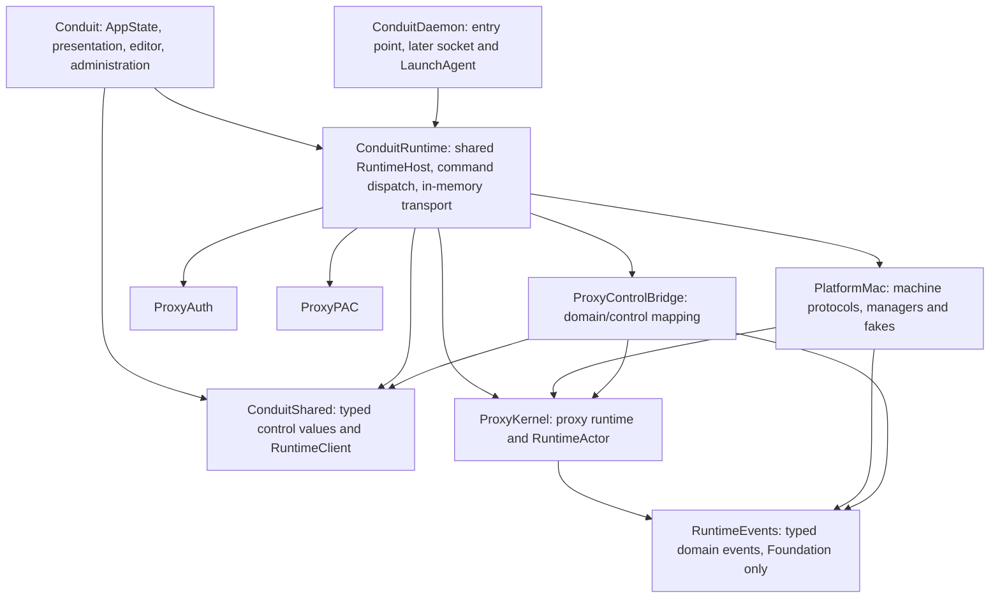

# Shared runtime contracts and host: owner review draft

Date: 2026-10-24. Status: **proposal for owner review, not an ADR or implementation authorization**.

Prepared by Codex with three Claude Code architecture-review passes, using the owner's
`claude.ai` Max subscription. The review used read-only repository tools, disabled
API/provider overrides and hooks, and made no source changes. The staging was
requested by the owner; concrete types, targets, compatibility rules and limits
below remain recommendations until the owner decides. Existing accepted
[decision 0001](./decisions/0001-one-runtime-host.md) and
[decision 0002](./decisions/0002-daemon-first-ownership.md) retain their status.
No new ADR is written by this document. [ROADMAP](../ROADMAP.md) remains the queue.

## Purpose and current constraints

Daily use is stable. Reduce defects discovered during development by combining
one implementation of runtime policy, types that reject invalid combinations,
and independent models that explore operation orderings. Type safety and model
checks accompany each host slice; neither requires a whole-repository conversion
before extraction.

The current sources establish several constraints:

- [AppState](../Sources/Conduit/App/AppState.swift) and
  [DaemonRuntimeHost](../Sources/ConduitDaemon/DaemonRuntimeHost.swift) are separate
  main-actor runtime hosts. The existing daemon is not the installed production
  owner and has no production control server.
- [ProxyOrchestrator](../Sources/ProxyKernel/Proxy/ProxyOrchestrator.swift),
  [LifecycleLane](../Sources/PlatformMac/LifecycleLane.swift),
  [RuntimeReconciler](../Sources/PlatformMac/RuntimeReconciler.swift) and
  [ConfigReapplyRetry](../Sources/PlatformMac/ConfigReapplyRetry.swift) also depend
  on main-actor isolation. Moving the host alone cannot complete isolation.
- [DaemonClient](../Sources/ConduitShared/DaemonClient.swift) is synchronous and
  reads a response until EOF; it is not the proposed subscription-capable client.
  The current control frame bound is 16 KiB.
- [ControlDaemonStatus](../Sources/ConduitShared/ControlProtocol.swift) omits VPN,
  error, upstream, connection and other state rendered by
  [RuntimePresentationAdapter](../Sources/Conduit/App/RuntimePresentationAdapter.swift).
  Reusing that thin status as the entire UI contract would lose behavior.
- [RuntimeEvent](../Sources/ProxyKernel/Models/RuntimeEvent.swift) has string names
  and details. A search on this checkout found 108 detail-matching expressions
  across 47 simulator/test files; these are migration inventory, not 108 proven bugs.
- AppState persists config, platform integration and UI preferences in separate
  writes. They are not one atomic transaction. #182 versions the platform-state
  journal, not these configuration files.
- #207's stale health-completion fence, #211's split-DNS repair and #212's
  reapply retries/PAC repointing already shipped in 0.5.7. They are baseline
  behavior to preserve and model, not work awaiting a sequencing decision.

## Proposed ownership and dependency shape



Recommended target placement, pending owner approval:

- Add **ConduitRuntime** for the shared host. Putting it in PlatformMac would
  broaden PlatformMac's dependency graph to auth, PAC and control mapping;
  ConduitUpdater already links PlatformMac. Keep the updater out of that graph.
- Keep control commands, result DTOs, snapshot DTOs and the async client interface
  and **ControlCodec** in **ConduitShared**, with no dependency on ProxyKernel.
  Keep **ProxyControlBridge** as the domain/control projection layer;
  transport/server adapters belong above it. Control event records are a distinct
  typed wire projection, not RuntimeEvents producer cases. ConduitShared does not
  import RuntimeEvents; exhaustive bridge switches and compatibility fixtures
  check the mapping.
- Prefer a small **RuntimeEvents** target for reusable domain event cases and
  safe diagnostic text. It has Foundation only, no commands, sockets, platform
  services or kernel objects. ProxyKernel must not import a combined
  event/control-client target. Introduce this small target with the first family,
  avoiding a second event-type move later.
- Keep existing grammar, helper IPC and configuration file formats in place for
  now. The full #78 split and broad #85 kernel decomposition are not prerequisites.
- New first-party declarations use `package` access. No external package or
  concrete cross-target public API is proposed.

The composition boundary injects existing managers/services, paths, fakes, clocks,
credential provider, observer seams and shutdown policy. It does not introduce a
protocol per manager or a generic service locator. AppState cannot obtain a live
manager/orchestrator through the client.

## Client, commands and outcomes

Illustrative names below describe the intended shape; these snippets are not
compilable implementation or a final exhaustive command list. Control message
values are `Codable`, `Sendable` values. Local stream handles are not encoded.

```swift
package protocol RuntimeClient: Sendable {
    func submit(_ request: ControlOperationRequest,
                budget: Duration) async throws -> ControlAdmission
    func outcome(of operation: ControlOperationID,
                 budget: Duration) async throws -> ControlOperationLookup
    func subscribe(_ request: ControlSubscriptionRequest) async throws
        -> RuntimeSubscription
    func readPage(_ request: ControlPageRequest) async throws -> ControlPage
}

package enum ControlRuntimeCommand: Codable, Sendable {
    case setModuleState(ControlModule, ControlRequestedState)
    case restart(ControlModule, ifRevision: ControlLifecycleRevision)
    case applyCommittedConfiguration(ControlConfigurationCommit)
    case testUpstream(ControlUpstreamReference)
    case testDNS
    case previewPAC(ControlPACPreviewRequest)
    case refreshPreflight
}

package enum ControlAdmission: Codable, Sendable {
    case accepted(ControlOperationID)
    case joined(ControlOperationID)
    case rejected(ControlRejection)
}

package enum ControlOperationLookup: Codable, Sendable {
    case pending
    case finished(ControlOperationOutcome)
    case unknown(ControlUnknownOutcomeReason)
}

package enum ControlOperationOutcome: Codable, Sendable {
    case completed(ControlCompletion)
    case superseded(by: ControlOperationID)
    case partiallyApplied(ControlSurfaceOutcomes)
    case failed(ControlFailure)
}
```

Use explicit requested state, not a UI-derived `toggle`. The runtime admits or
joins a lifecycle operation based on authoritative state; a lagging presentation
snapshot never authorizes a machine mutation. A stop reply means admission until
its operation outcome says it settled. Host exit is an entry-point policy, not
`exitAfter: Bool` in a common proxy-stop command.
State setters reduce replay risk but do not eliminate physical-effect ambiguity.

Transport failure is distinct from a domain rejection or failed apply. Request,
operation, host incarnation, lifecycle, configuration and presentation revisions
have distinct value wrappers. Command preconditions compare the relevant
lifecycle/configuration revision, not a presentation revision that advances on
traffic counters. Stable machine-readable codes accompany sanitized human descriptions.
Derived values such as direct-mode boolean come from one typed cause; independent
writable booleans must not contradict that cause.

### Completion, cancellation and retry

- A caller budget bounds waiting; a local timeout after a possible send does not
  prove that the command was rejected. Report an unknown outcome when admission
  cannot be established, retain correlation identifiers and query state/outcome.
- Cancellation before send admits no work. After possible admission it detaches
  the waiter; it does not promise to stop physical effects or roll them back.
  A later explicit lifecycle command supersedes earlier intent through the owner.
- Same-request coalescing/result lookup is bounded and scoped to a host
  incarnation. A bounded cache is not durable exactly-once execution. Expired
  history, disconnect and restart must have explicit unknown/expired outcomes;
  mutating commands are never automatically replayed.
  `ControlUnknownOutcomeReason` includes expired history and changed incarnation;
  these are explicit reasons inside the lookup's `unknown` case.
- If retry deduplication is offered, specify client-session lifetime, content
  equality and rejection of expired request sequences. A UUID cache alone cannot
  reject duplicates after eviction. Prefer the minimal no-blind-retry contract
  until a concrete consumer needs more.
- Request, admission, operation completion and observable publication are distinct.
  Include the settled state revision in completion; clients may wait for that
  revision when they need the presentation to catch up.

## Snapshot, observation and bounded subscriptions

`ControlRuntimeSnapshot` must cover the UI inventory: module/run/error states,
actual bindings, routing/direct-mode cause, VPN/interface and flap metrics,
auth outcome/time/reason, raw counters/uptime, upstream health, active-connection
counts/details, tunnel resolver status and host/helper/preflight problems.
Configuration references identify desired and durable generations; per-surface
applied-state detail is introduced with #194 and is explicitly unavailable until
then, never inferred from a saved flag. Counter reset baselines, editor drafts,
window state and the UI's render coalescing remain local presentation state.

Full UI coverage does not require an unbounded array in one frame. Large
collections use bounded pages tied to an explicit collection revision referenced
by the snapshot. Pin a bounded immutable view rather than invalidating every page
when an unrelated traffic counter changes. Bound retained collection versions,
their total bytes, cursor count and lifetime. Counts remain totals;
pages explicitly report continuation/staleness and preserve the existing views'
ability to inspect records. Do not silently replace the connection view with a
sample. Stage 1 must inventory every RuntimePresentationAdapter field and every
AppState-only read used by views/preflight against the replacement contract.

```swift
package enum ControlRuntimeFrame: Codable, Sendable {
    case baseline(ControlBaseline)
    case snapshot(ControlRuntimeSnapshot)
    case events(ControlEventBatch)
    case replayCaughtUp(ControlEventCursor)
    case operationFinished(ControlOperationID, ControlOperationOutcome)
    case end(ControlStreamEnd)
}
```

Proposed stream semantics:

1. Capture the baseline and event high-water cursor and register the subscriber
   atomically in the runtime owner's isolation. The first frame is the baseline.
2. Snapshot revision and event sequence are different counters, scoped to an
   incarnation. Snapshot frames replace presentation state; event frames explain
   decisions and must not be replayed as commands or state mutations in the UI.
3. With a valid resume cursor, baseline metadata declares the bounded replay
   range through its high-water cursor. Send replay in sequence, mark catch-up,
   then send live events. With no cursor, start live after the captured high water.
   An unavailable range or changed incarnation is explicit; a baseline restores
   state but cannot recreate lost diagnostic events.
4. Unsent complete presentation snapshots may coalesce. Decision events and
   operation outcomes cannot be silently dropped or inferred from strings.
5. On byte/item overflow, terminate the stream with a typed slow-consumer/resync
   reason outside its full data queue. Reserve bounded terminal-control capacity;
   if a blocked socket cannot deliver even that frame within its write budget,
   disconnect. Clients resubscribe after either explicit resync or disconnect,
   retaining their own last consumed event cursor. Runtime work continues. Never
   enqueue one Task per event or let a subscriber block the owner.
6. Cancellation/disconnect releases the subscriber promptly; one client's
   disconnect does not shut down RuntimeHost. Page cursors and pending waiters
   have bounded lifetimes too.

Suggested starting limits for review, not new shipping defaults: a 16 KiB v2
frame bound (including its envelope), 8 subscribers,
32 pending commands, 128 retained terminal operation outcomes, a 512-event replay
ring, 64 queued frames and 1 MiB queued bytes per subscriber, and at most 64 rows
per page subject to the frame byte bound. Also bound individual strings, event
batches, active operations, page-cursor state and replay lifetime. Stage-1 sizing
must show the largest valid baseline/page fits the chosen frame bound; if it
cannot, bring a specific paging/schema or larger-v2-bound choice to owner review.
The v1 bound is unchanged. Reject
or explicitly split oversize data; do not rely on item count alone.

The in-memory default encodes/decodes the same frames and exercises the same
bounded admission and stream rules as the future socket. It is not a direct
method shortcut. Codec/transport conformance tests run independently of host
composition. Measure its cost before proposing a fast path.

### Compatibility

Preserve existing v1 commands, response behavior, codes and the 16 KiB frame
limit. Propose an explicit v2 for the new command and streaming shapes, including
the in-memory codec and its fixtures. This does not ship a production v2 socket
in 0.6; that server remains part of the daemon milestone. In-process peers are
the same binary; external peers later negotiate deliberately. Unknown/missing versions or commands
fail closed. Teaching new clients to decode an unknown enum value does not make
an old binary understand it. A v1 endpoint continues its old adapter behavior;
it does not silently reinterpret a v2 operation as the old OK response.

Known payloads are validated; malformed known events are not reclassified as
unknown. Unknown informational events can be retained as bounded, redacted wire
records for display/export. Additive `fields` in existing event envelopes require
fixtures showing old readers still work. Files and stdout use CanonicalJSON;
helper and control codecs retain their existing timestamp contract. Helper IPC
and app/daemon control are separately versioned protocols: control v2 does not
change the installed helper's IPC version. The in-memory codec validates its
version even though same-binary peers need no network negotiation.

## Typed events, without an untyped producer escape hatch

First family: **lifecycle**, covering coalescing/supersession/termination outcomes,
with its producers and simulator consumers migrated together. Extend config,
DNS/tunnel, VPN/connectivity/routing, PAC and auth families as the owning slices
move. Each migrated name has a typed case/payload; reason enums, identifiers and
numeric counts replace string assembly. Name, category, structured fields and
human detail derive from that case.

```swift
package enum LifecycleEvent: Codable, Sendable, Equatable {
    case superseded(LifecycleSuperseded)
    case coalesced(LifecycleCoalesced)
    case terminationDrainExpired(TerminationDrainExpired)
}
```

Credentials, cookies, authorization headers and SecretBytes never enter Codable
event values. Diagnostic text/targets use deliberately sanitized representations;
keep sink sanitizers as defense in depth. Preserve the existing sanitizer's
behavior and redaction fixtures if its pure implementation moves targets.

A temporary legacy envelope is allowed only for unmigrated families, with a
checked migration inventory. Internal producers cannot emit an arbitrary unknown
name after their family migrates. External unknown records are a decoder concern.
Golden fixtures protect stable names/kinds and the legacy human detail, while
semantic assertions match typed fields. Generate the catalogue from schema
metadata when coverage is complete; keep the existing catalogue gate for legacy
families until replacement coverage is equivalent. Do not use reflection as the
only safeguard against secret-bearing payloads.

## Configuration and administrative boundaries

Recommended interim authority: AppState owns editing and the current persistence
policy during in-process convergence. An injected configuration store has one
write authority; RuntimeHost receives immutable committed inputs. It does not
keep a second independently mutable config-file cache.

A proposed `ControlConfigurationCommit` carries the actual successfully persisted
runtime component values (config/platform integration) plus per-component durable
receipts and a runtime revision precondition. Values for failed component writes
do not masquerade as committed. The host validates this typed control projection
and applies exactly those values, not newer bytes read from mutable paths. UI
preferences are separate. Partial multi-file persistence stays explicit; no
atomicity is claimed and #182 is not repurposed to provide it.

Before introducing that payload, classify every field in the config projection:
absence of a property called `password` does not prove URLs or free text contain
no secrets. Secret-bearing values must remain in the private credential/config
provider rather than this Codable payload. If this prevents a useful value
projection, the alternative is a bounded exact-revision store reference. Such a
store must resolve the original immutable inputs or reject as superseded; an
opaque revision followed by a read of newer files is insufficient. The value
projection is the preferred shape; its complete field inventory remains an owner
review and stage-1 design obligation, not a claim that raw ProxyConfig is wire-safe.

For actions that currently persist DNS/tunnel/proxy intent, the AppState action
adapter remains the persistence authority and passes the committed intent through
the client. RuntimeHost never calls back into a live AppState to save a flag.
**An owner choice remains about action ordering:** Codex recommends persist intent
before admitting its runtime change; Claude prefers persisting intent after the
runtime outcome. Persist-first can leave a durable requested setting whose apply
fails; act-first can leave runtime state whose persistence fails. Both require
explicit durable/desired/applied reporting, failure policy and reconciliation.
Preserve current behavior during extraction; select and test any policy change
against start/stop/quit semantics and #194 before migrating that action. Ephemeral
start/stop and durable configuration intent must be explicit in the command map.

Before production daemon adoption, transfer runtime-config write authority to the
daemon-side store through a separately reviewed commit/configure operation.
AppState keeps the draft; it no longer writes runtime configuration independently.
Define expected revision, partial failure and crash recovery at that handoff.

| Concern | In-process convergence | Production daemon gate |
| --- | --- | --- |
| Config drafts, UI preferences, windows | AppState | AppState |
| Runtime config persistence | Existing AppState authority, explicit store/receipts | Daemon-side sole writer; reviewed handoff |
| Runtime platform managers and journal | Shared RuntimeHost | Exclusively admitted daemon owner |
| Login-item policy/reconciliation | Existing app administrative/config authority; #194 launch reconciliation | Decide app-login vs daemon LaunchAgent policies separately |
| Credential enrollment/clearing | App-side credential service, existing Keychain policy | Enrollment/cache-invalidation contract and session validation |
| Credential use | Injected runtime provider; no secret payloads | User-session provider; real Keychain/Kerberos evidence |
| Helper install/uninstall, admin UI | App administrative service; typed status refresh into host | Separate authenticated authority/maintenance policy |
| Notifications and updates | App services consume events/request runtime shutdown | Explicit daemon/update policy; UI exit is not runtime stop |

No new synchronous main-thread authorization bridge is proposed. Preserve the
existing injected privilege operations during extraction. Changes to elevation
fallback are separately reviewed with #48's single-writer authority contract.
Do not make a platform worker wait for UI while the UI waits for that worker.
Preflight, PAC preview, upstream tests and DNS tests need async value APIs too;
credential enrollment, helper administration and updates are not generic runtime
commands carrying passwords, scripts or arbitrary paths.

AppKit termination should use its asynchronous terminate-later/reply handshake
with a documented total budget. RuntimeHost owns bounded shutdown/drain outcomes;
the app owns AppKit policy, and RuntimeHost imports no AppKit. In-process quit
still stops its runtime. Later daemon-mode UI quit only disconnects; explicit
runtime stop, logout and update shutdown have separately specified policies.

## Isolation and verification alongside each slice

Extract with current isolation first. Proposed stage-4 end shape is a shared
`RuntimeActor` for the runtime control-owner cluster, declared in a low-level
ProxyKernel abstraction so PlatformMac and ConduitRuntime can use it without a
control/transport dependency. Move orchestrator, host, lifecycle, reconciler and
runtime retry/observer decision state cohesively in reviewable steps. Keep NIO
channel work on its loops and blocking platform effects on PlatformWork. The UI
presentation adapter and AppKit services remain MainActor.

For #47, explicitly move the remaining reconciler/reapply, split-DNS gate/file,
termination clear and TCP-relay helper operations off MainActor. Total quit
includes per-call helper budgets and manager-lock waits, not only a queue-drain
timer. Supersede pending starts and retain recoverable journal state when a
budget expires; do not claim teardown completed because the UI stopped waiting.
Do not start new authorization UI during drain. Any necessary privilege/fallback
policy refinement is explicit for owner review, not hidden in extraction.

Actor isolation does not make an operation atomic across awaits. Retain lifecycle
tokens, manager serialization and stale-completion checks. Recheck delayed
observations at their owner. Already-started effects may finish after supersession;
keep corrective intent visible rather than asserting that no physical write can
occur. Preserve decision 0011: judge connected sockets by path; this program does
not restore routing stamps on requests or introduce a second socket registry.

#183 runs the production policy (or a faithful adapter) in lockstep with an
independent reference model. Testing a reference model against itself is not
verification of the implementation. Explore pending effect completions as commands
so stop/start/config interleavings become controllable.

| Model | First relevant slice | Checks |
| --- | --- | --- |
| Subscription/admission | Client boundary | Baseline first, ordered replay/live handoff, bounded queues, explicit gaps, cancellation and unknown admission |
| LifecycleLane | Before lifecycle migration/isolation | Live tokens/accounting, joins, supersession, quiescence and delayed completions |
| Config/applied surfaces | Proxy migration and #194 | Durable vs desired/applied, partial failure, inverse edits, retained corrective work |
| Health scheduling | #181 | One physical run across restart, dropped ticks, one explicit follow-up, stale result/pool-effect fencing |
| Breaker, VPNStateFuser, ConfigDiff | Their state owners are touched | Preserve #183's original model scope; bounded exhaustive or seeded mode as appropriate |

Small finite spaces use breadth-first bounded exploration with complete
model-relevant deduplication keys, discrete time and stated depth/state/transition
budgets. Exceeding a budget fails the exploration's coverage assertion. Larger
inputs use replayable seeds and minimized histories. Demonstrate injected-bug
sensitivity against the production adapter and print the shortest counterexample
or seed/history. State precisely which bound was checked; do not claim all real
Task/NIO schedules are proved. Harness and pm-sim cases still cover actual effects.

## Delivery slices and owner choices

The queue and release scope are in ROADMAP. Suggested reviewable implementation
slices after owner approval and the necessary decisions:

1. #23 dev bundle independently; #118 teardown/reproducer investigation ahead of
   substantial isolation work, without declaring its race cause established.
2. Contract, codec, in-memory transport and conformance/model tests; lifecycle
   event family through producer, wire/file output, consumers and assertions.
3. Extract ConduitRuntime from the daemon with existing policy and fake-machine
   coverage. No production process switch or helper contract change.
4. AppState DNS, tunnels, then proxy adoption, deleting copies and migrating each
   slice's events/models. Keep both harnesses until parity permits consolidation.
5. Cohesive runtime isolation including ProxyOrchestrator, lane/reconciler/retry
   state and observer delivery; meet every #47/#79 acceptance item and total quit
   bound. This completes the proposed 0.6 core.
6. Separately scoped #194 applied-state and #181 scheduler improvements; a bounded
   applied-state slice may join 0.6. Preserve #182's existing journal migration
   schedule and independent focused correctness patches.
7. Later production daemon socket, exclusive ownership/recovery (#48, #32/#76),
   LaunchAgent lifecycle and real user-session evidence. One implementation is
   distinct from one production owner.

Every implementation slice runs the repository-required checks, full host parity
where still applicable, pm-sim and performance gates. This planning-only change
runs documentation/decision checks; it makes no runtime-validation claim.

The owner should decide the following before ADRs and implementation:

| Choice | Recommendation or remaining owner choice | Consequence |
| --- | --- | --- |
| Module shape | ConduitRuntime plus a small event-only RuntimeEvents; control DTOs/client stay ConduitShared | Avoids updater dependency growth and a kernel-to-control dependency |
| Contract and compatibility | Encoded in-memory transport, explicit v2 command/stream contract, lifecycle first | Exercises future daemon semantics now; keeps v1 compatibility deliberate |
| Admission and stream semantics | Admission separate from settlement, no blind mutation retry; baseline/replay/live ordering and explicit overflow termination | Honest unknown outcomes and bounded memory; no exactly-once claim |
| Config authority | AppState remains interim writer; validated committed values with exact component receipts; select persist-first vs act-first policy | Avoids a new writer; field classification, action ordering and later daemon handoff need specific tests |
| Isolation and scope | RuntimeActor for the full control-owner cluster in 0.6 core; applied state/scheduler separately scoped; leases later | Moving only the host cannot be called completion |

Concrete limit values and the full command/field inventory require stage-1 sizing
and compatibility fixtures before those APIs are considered settled. Any owner
choice that refines an accepted decision receives a new ADR or the appropriate
implementation/evidence update only after approval; no accepted record is rewritten
into a different decision.
